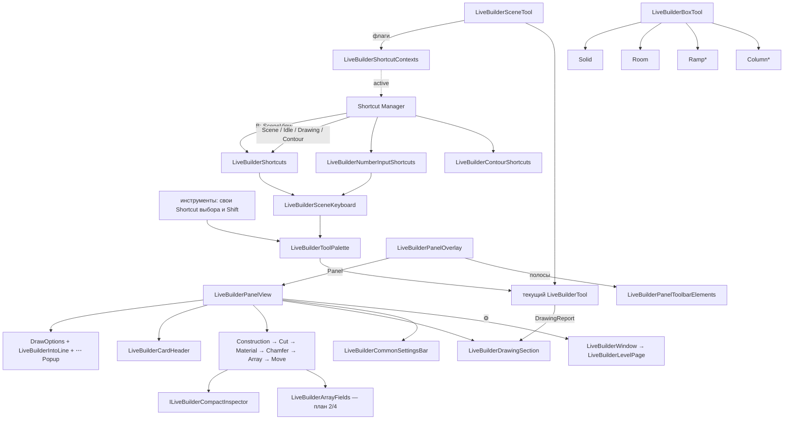
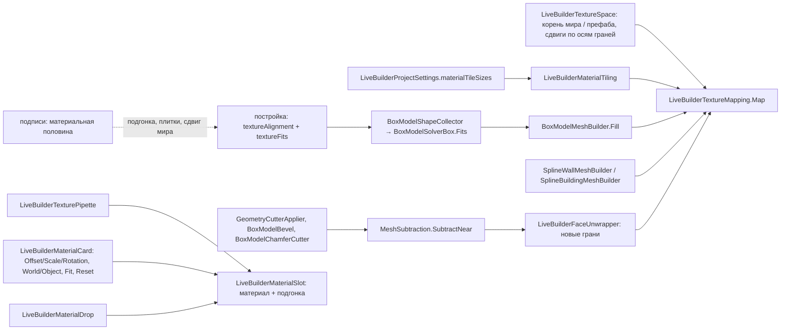
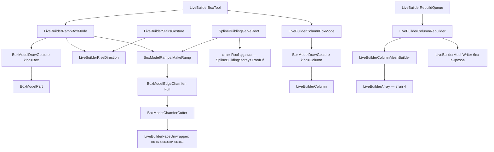

# План этапов 3, 5 и 6 Live Builder (архитектор)

Код не писал, Unity не запускал. Опора: код FeatherKit на 20.11.2026 (этап 1 в работе — номера строк могут съехать на 5–20),
[LiveBuilderRework.md](../LiveBuilderRework.md), [LiveBuilder.md](../LiveBuilder.md), [Stage1.md](Stage1.md), [Stage2and4.md](Stage2and4.md),
разбор дизайнера [UX-Review.md](UX-Review.md) и макет [UX-Mockup.html](UX-Mockup.html), решения менеджера [Decisions.md](Decisions.md),
библиотеки Unity 6000.6.4f1 с диска (атрибуты ярлыков в `UnityEditor.*.dll`, документация `*.xml`). Интерфейс этапа 3 — по разбору
дизайнера; где я с ним расхожусь — раздел 3.12. Ссылки на код — от корня пакета FeatherKit.

**Слова:** этаж — `Storey` везде (в интерфейсе и в иерархии здания: `Storey 1`, `Storey 2`…), перекрытие — `Slab`, крыша — `Roof`,
пол — `Floor` (только пол). Там, где [Stage2and4.md](Stage2and4.md) пишет `Floor N`, читать `Storey N` ([Decisions.md](Decisions.md)).

---

## 0. Суть простыми словами

- **Этап 3.** Вместо окна с вкладками — одна панель в окне сцены: сверху 8 значков инструментов, под ними — режим и настройки
  инструмента и строка «Into: …» (куда встанет новое), ниже — карточка выделенного с путём «Section › Storey 2 › Box» и секциями всегда
  в одном порядке, внизу — этаж и сетка. Пока рисуешь — вместо карточки живые размеры и набранное число. Панель можно поставить колонкой
  у края или полосой сверху. Окно Live Builder — только настройки уровня. Клавиши — в стандартном окне Edit → Shortcuts.
- **Этап 5.** У каждой стороны — сдвиг, масштаб и поворот текстуры, у материала — «метров на плитку»; новые постройки — текстура по миру,
  без швов между этажами и коробками. Alt + клик — взять, Alt + правый клик — положить.
- **Этап 6.** «Коробка» получает режимы Ramp (пандус) и Column (колонна 4–32 стороны); у здания-прямоугольника — кнопка Gable Roof.
  «Открытая» лестница уже есть — переименуем.

---

## 1. Что делаем и зачем — на примерах

**Этап 3.** Автор строит подъезд. B, «5», контур кликами — здание встало и выделено; первая строка карточки — `Storeys 9`, заголовок —
`Section A › Building`. «3» — «Вырез», в строке инструмента `Window 1.5 × 1.5`, `To top` нажата, `Into: Building › Storey 2`; клик
по стене — окно на всех этажах выше, Shift + клик — ряд во всю стену. «2» — «Коробка» в последнем режиме; «2» ещё раз — Room;
Shift+2 — обратно Solid. Пока тянешь коробку, в панели `Drawing new Box · step 2 / 2 · Height`, `Typed 4 × 3 × 1,5▌`,
«Enter — box 4 × 3 × 1.5». Окно Live Builder не открывалось.

**Этап 5.** Материал «Panel» — 3 × 3 м. Здание с этажом 3 м по сетке 3 м: швы панелей на перекрытиях всех девяти этажей, балкон
продолжает рисунок. На одной стене сдвинуть рисунок на полпанели — `Offset U 1.5`; на соседней коробке так же — Alt + клик, Alt + правый клик.

**Этап 6.** Двор: «2» до Ramp, протянул 2 × 6 м, высота 1 м — пандус вверх к концу протягивания, Tab — повернуть. Навес: здание 6 × 4 в один
этаж, Gable Roof. Колонны: режим Column, 0,4 × 0,4, высота 3 — 16-гранная колонна; ряд — секцией Array.

---

## 2. Что берём из плана этапов 2 и 4 — точки стыка

Вместо прежних допущений — то, что решено в [Stage2and4.md](Stage2and4.md). Каждая строка — место, где этот план опирается на него.

| Из плана 2/4 | Что это для этапов 3, 5, 6 |
|---|---|
| `BoxModelPart` только добавляет; поля `mode`/`cutTargets` скрыты (миграция) | у коробки в карточке нет переключателя Add/Cut — кнопка **Make Cut** (`BoxModelActions`, «Add ⇄ Cut» плана 2/4, шаг 2.2); у выреза формы Box — **Make Box** |
| Вырез — всегда `GeometryCutter`, в том числе коробка в объекте (`BoxModelFactory.CreateCutterBox`); «Where it cuts» `OwnObject` / `EverythingItTouches`; «Cuts» всё / перекрытия / стены; новому — `GeometryCutterDefaults` | инструмент **Cut** правит только `GeometryCutter`; «Коробка» в Auto/Cut и push/pull внутрь ставят вырез (так у плана 2/4); секция **Cut** карточки — поля `GeometryCutterEditor`; строка «Cuts now: …» — через `LiveBuilderCutRules` |
| `GeometryCutterSideMaterials` — материалы стенок выреза по сторонам (низ, верх, бока, ±X, ±Z) | секция **Material** выреза — стороны как у коробки; этап 5 — подгонка по тем же сторонам |
| Комната — только `BoxModelRoom` (вырез + оболочка `BoxModelRoomShell`, 6 коробок), **только прямоугольник**; `LiveBuilderRooms` удалён | режим **Room** «Коробки» — только прямоугольник; клик без протягивания — подсказка «Room by outline — Wall (closed) or Building, 1 storey» |
| `LiveBuilderArray` (Count/Step XYZ, `stepYIsStoreyHeight`, `countYToBuildingTop`, Skip, этап 4: Mode Count/Fill, Along Axes/Wall, Pattern); поля рисует `LiveBuilderArrayFields`; действия — `LiveBuilderArrayActions`; предупреждения — `LiveBuilderArrayCopyPoses.WarningsOf`; карточка — `LiveBuilderArrayCard` | секция **Array** = `LiveBuilderArrayCard`, переведённая в панель; «и этажи выше» везде одно: кнопка **To top** с одним значком (= `countYToBuildingTop`) — в строке инструмента и строкой «Y — up: To top» в Array; пустая Array — «+ Add» с меню `LiveBuilderArrayActions` (To top, Along X, Along Z, Along wall) |
| Этажи — объекты `SplineBuildingStorey` в здании (`SplineBuildingStoreys.ContainerOf`/`RoofOf`/`BuildingOf`/`StoreyOf`), имена — `Storey N` и `Roof` ([Decisions.md](Decisions.md)); `SplineBuildingLevelPlacement` — на каком этаже уровня, высота «уровня» или своя | путь в заголовке карточки и строка **Into** берут этаж из иерархии; Construction здания — `Storey height [ ] Level` (связь с уровнем); секция Inside — этажи плашками; Gable Roof — в `RoofOf(building)` |
| Здание всегда во внешнем объекте (`Section`), части `Walls`/`Slab` в этажах | путь `Section A › Building › Storey 2 › …` |
| Удалены `LiveBuilderStoreyLinkCard`, `LiveBuilderRepeatCard`, `LiveBuilderRepeatHandle`, `SplineBuildingLinkSync`, `IStoreyCopies` | этап 3 их не трогает |
| Этап 4: `LiveBuilderModuleTool` — седьмой, Shift + клик — ряд (`LiveBuilderArray` Along Wall, Mode Fill, Length 0); `LiveBuilderWallFitting` вынесен из `LiveBuilderOpeningPlacer` | ярлык Module — 7 в файле инструмента; Shift + клик у **Cut** — то же: проём + `LiveBuilderArray` Along Wall / Fill на самом проёме (`LiveBuilderArrayActions`) |
| Порядок очереди: `LevelSync → StoreySync → AnchorSync → WallLineSync → ArraySync → ArrayCopyPoses.BeginPass → BoxModels → Buildings → Walls → EndPass` | шаг колонн этапа 6 — после `BoxModels`, до `EndPass` (копии колонны — из `LiveBuilderArrayCopyPoses.CopiesOf`) |
| Порядок этапов 1 → 2 → 3 → 4 → 5 → 6 | этап 3 рисует секцию Array из `LiveBuilderArrayCard` этапа 2; Module и поля этапа 4 появятся в той же секции без правки панели |

Порядок этапов можно менять (3 и 4): секции и инструменты панель находит каталогом типов (`LiveBuilderTypeCatalog`) сама.

---

## 3. Этап 3 — интерфейс

### 3.1. Как сейчас (по коду)

- **Окно** `LiveBuilderWindow` (`Editor/FeatherKit/LiveBuilder/LiveBuilderWindow.cs:20`): шапка вкл/выкл и список клавиш
  (`:141-214`), палитра плитками в два ряда (`:230-270`), строка о выделенном (`Window/LiveBuilderSelectionStrip.cs`), строка общего
  (`Window/LiveBuilderCommonSettingsBar.cs`), три вкладки (`Window/LiveBuilderToolTab.cs`, `Window/LiveBuilderSelectionTab.cs`,
  `Window/LiveBuilderLevelTab.cs`), «?» с длинными пояснениями, подсказка внизу. Вкладки переключаются сами (`:343-385`).
- **Панель в окне сцены** `LiveBuilderSceneOverlay` (`LiveBuilderSceneOverlay.cs:12-13`) — `IMGUIOverlay` в **верхней полосе**
  (`DockZone.TopToolbar`): значки инструментов, этаж ◀ ▶, «Всё / Комнаты / Стены вниз», кнопка «Окно». Карточку в полосу не положить.
- **Инструмент окна сцены** `LiveBuilderSceneTool : EditorTool` (`LiveBuilderSceneTool.cs:20-21`). Клавиша B — единственный ярлык
  Shortcut Manager: `[Shortcut("FeatherKit/Live Builder", typeof(SceneView), KeyCode.B)]` (`:56-60`), только включает.
  Все остальные клавиши ловятся вручную в `OnToolGUI` по `EventType.KeyDown` (`:131-135`) → `OnKeyDown` (`:280-354`): сначала
  `tool.OnKeyDown`, потом цифры 1–9 по месту в палитре (`:292-297`, `LiveBuilderToolPalette.TryGetByHotkey`, `Tools/LiveBuilderToolPalette.cs:75-81`),
  `[` `]`, PageUp/PageDown, S, «/», Tab (лестница), Esc. Клавиши контура (C, стрелки, Delete) — `LiveBuilderContourKeys.cs:28,50,78-99`.
  В окне Shortcuts этих клавиш не видно, переназначить нельзя.
- **Инструменты** — 8 наследников `LiveBuilderTool` (`Tools/LiveBuilderTool.cs:17`): Select 0, Box 1, Room 2, Wall 3, Building 4,
  Stairs 5, Opening 6, Ruler 7 (`PaletteOrder`); клавиша = место + 1. Настройки — `DrawSettings` / `DrawMoreSettings` (`:171-180`),
  рисует вкладка «Инструмент».
  - `LiveBuilderRoomTool` (`Tools/LiveBuilderRoomTool.cs`) — два жеста: прямоугольник (`LiveBuilderRoomGesture`) и контур
    (`LiveBuilderPathGesture`, `:18-19,55`); правит всё, что `LiveBuilderRooms.IsRoom`.
  - `LiveBuilderOpeningTool` (`Tools/LiveBuilderOpeningTool.cs`) — клик по стене: готовый размер (`LiveBuilderOpeningPlacer`),
    протягивание по любой поверхности: свой размер, насквозь или ниша (`LiveBuilderCutterGesture`, `:169-210`); правит `GeometryCutter`
    и вырезающие коробки (`:76-77`). В объекте из коробок протянутый прямоугольник уже даёт **вырезающую коробку** — то есть
    «вырезающая коробка + проём» в одном инструменте уже есть.
- **Карточки «Выделено»** — наследники `LiveBuilderSelectionCard` (`Window/Cards/LiveBuilderSelectionCard.cs:13`), порядок по `Order`:
  BoxPart 10 (режим, размер, «Режет», что задевает, скосы, под «Ещё» — угол и 8 материалов, `Cards/LiveBuilderBoxPartCard.cs:35-206`),
  Move 15, Repeat 20, OwnComponent 40 (целый инспектор компонента внутри окна, `Cards/LiveBuilderOwnComponentCard.cs:20-41`),
  PathPoints 50, LevelAlignment 60, StoreyLink 70, InnerObjects 80, Group 85, BuildingPart 90.
- **Шпаргалка** в углу сцены — `LiveBuilderSceneKeys.cs`, клавиши записаны строками (`:36-42`).
- **Подписи** — по-русски везде.

### 3.2. Конфликты стартовых клавиш со стандартными Unity (проверено по библиотекам 6000.6.4f1)

Стандартный профиль Unity, атрибуты `[Shortcut]` из `UnityEditor.*.dll` и пакетов проекта (Splines, ProBuilder, URP, Terrain…):

| Клавиша | Чем занята в Unity | Контекст Unity | Что это значит сейчас |
|---|---|---|---|
| **2** | `Scene View/Toggle 2D Mode` | окно сцены | вероятно, сейчас «2» в Live Builder переключает 2D вместо «Коробки», и «2» в наборе «2,5» тоже |
| **S** | `Overlays/Show Tool Settings` | окно сцены | S (прилипание к точкам) делит клавишу с панелью настроек инструмента |
| **X** | `Tools/Toggle Pivot Orientation` | глобально | известный риск «4 X 3» (LiveBuilder.md, «Ждёт проверки») |
| ← ↑ → ↓ | `3D Viewport/Fly Mode … (Alt)` | `SceneViewMotion+SceneViewViewport` | стрелки точек контура делят клавишу с полётом камеры |
| B, 1, 3–8, `[`, `]`, PageUp, PageDown, Enter, Esc, Tab, `/`, C | не заняты (Unity: только `Ctrl/Cmd+[`, `Ctrl/Cmd+]`, `Ctrl/Cmd+/`; Splines C — только в своём контексте) | — | конфликтов нет |
| Alt + ЛКМ, Alt + ПКМ | вращение и приближение камеры (`SceneViewMotion`, не Shortcut Manager) | окно сцены | пипетка этапа 5 — только клик **без протягивания** |

Как Unity решает спор «свой контекст против контекста окна»: оба официальных пакета делают ровно то, что предлагаю, — свой
`IShortcutContext`, зарегистрированный `ShortcutManager.RegisterContext` на время инструмента, и клавиши, уже занятые Unity:
Splines — X (`com.unity.splines/Editor/Tools/SplineTool.cs:78-89,168-169,316`) против глобального X, ProBuilder — H
(`com.unity.probuilder/Editor/EditorCore/ProBuilderToolsContexts.cs:23-28,147`) против `Scene Visibility` H. Значит,
зарегистрированный контекст сильнее. **Проверить в редакторе** первым делом в шаге 3.1 (раздел 3.10); запасной вариант — там же.

### 3.3. Решения этапа 3

1. **Панель — `Overlay` с тремя раскладками: Panel (полная), Horizontal toolbar, Vertical toolbar.** Panel — `CreatePanelContent()`
   возвращает `IMGUIContainer` с IMGUI-кодом панели (все поля и инспекторы уже на IMGUI); полосы — `ICreateHorizontalToolbar` /
   `ICreateVerticalToolbar` из `EditorToolbarToggle` (UI Toolkit): 8 инструментов + этаж (+ сетка в горизонтальной). По умолчанию —
   `DockZone.RightColumn`, `Layout.Panel`, новый id `featherkit-live-builder-panel`, `minWidth` 220. **Panel — запасной вариант и первый
   шаг:** полосы — отдельным шагом 3.4; если на нём что-то не выйдет, панель в полосе Unity сворачивает до значка, клик — всплывает полная.
   Почему: «узкая и пристыкованная» без своего кода раскладки; цена — один класс элементов полосы.
2. **Порядок панели сверху вниз** (макет, «Устройство панели»): заголовок (вкл/выкл, ⚙ — окно уровня) → ряд 8 значков с клавишей в углу →
   строка инструмента (режимы значками, 1–3 частые настройки нового, **Into: …**, ⋯) → карточка (путь, тип · имя · размер, жёлтая строка
   предупреждения, секции) → нижняя строка `Storey ◀ N ▶ +пол │ Grid ▾ │ Snap │ View All·Rooms·Walls │ Wireframes`. Прокручивается только
   карточка; ряд значков и нижняя строка не уезжают.
3. **Строка инструмента — про новое, карточка — про выделенное.** Редкое — «⋯» во всплывающем окошке (`PopupWindow`); на «⋯» точка, если
   внутри не по умолчанию (`AreMoreSettingsChanged`, как нынешнее «изменено» у «Ещё»).
4. **«Into: Section A › Storey 2»** — куда встанет следующее, у Box, Cut, Wall, Stairs, Module, Building. Мышь над сценой — по месту под мышью
   (то, что инструмент уже ищет на движении мыши: `LiveBuilderBuildingContext`, плоскость рисования, `BoxModelActions.SelectedModel`), иначе —
   по выделенному и этажу. У «Коробки» ещё «· Auto → adds (outward)» во время рисования.
5. **Карточка: заголовок = путь + тип · имя · размер.** Путь — цепочка построек Live Builder и этажей над выделенным (`Section A › Building ›
   Storey 2 › Window South`), клик по звену выделяет его; в узкой панели путь сокращается с начала («… › Storey 2»). Размер — из
   `LiveBuilderSelectionInfo`. Предупреждения (повтор > 5000, контур пересекает сам себя, здание повёрнуто в своём объекте, модуль без выреза) —
   одной жёлтой строкой сразу под заголовком, а не в секции.
6. **Секции всегда в одном порядке: Construction → Cut → Material → Chamfer → Array → Move & Copies.** Нет данных у секции, которая может быть
   (Chamfer у коробки, Array у всего) — одна строка-кнопка «+ Add»; не может быть (Cut у здания) — секции нет. Plus — Points и Inside у стены
   и здания: после Construction; Group — у не-Live-Builder объекта вместо всего. Move & Copies — последняя и свёрнута.
7. **Construction — главные поля из инспектора постройки** (`ILiveBuilderCompactInspector.DrawMainFields`), «Тонко» — только в инспекторе Unity.
   У коробки — Size и **Make Cut**; у выреза-коробки — **Make Box**; Add/Cut переключателя нет (план 2/4).
8. **Несколько выделенных.** Одного вида — те же поля, правка всем, разные значения — «—» (`SerializedObject` с несколькими целями и
   `EditorGUI.showMixedValue`; для полей не из `SerializedProperty` — свой `LiveBuilderMixedValue`). Разных видов — плашки «2 Box · 1 Cut ·
   1 Building» (клик — оставить выделенными только их) и только общие секции: Array («+ Add to each») и Move & Copies.
9. **Пока рисуешь — секция Drawing вместо карточки** (синяя полоса): шаг жеста («step 2 / 2 · Height»), живые размеры, набранное «4 × 3 × 1,5▌»,
   что сделают Enter и Esc, замок у числа, набранного с клавиатуры. Строка инструмента притушена. Данные отдаёт сам инструмент
   (`LiveBuilderTool.DrawingReport`), панель их только рисует.
10. **Клавиши — `[Shortcut]` со своими `IShortcutContext`**, как Splines и ProBuilder (раздел 3.4). Цифры и X во время рисования — тоже ярлыки.
11. **Клавиша инструмента ещё раз — следующий режим, Shift + клавиша — предыдущий**; режим помнится. Room → Solid — Shift+2, одно нажатие.
    Ряд режимов виден в строке инструмента — мышью тоже один клик.
12. **Cut = нынешний «Проём»**: клик — готовый размер (виден в строке: `Window 1.5 × 1.5`), протянул — свой; режимы — Rect / Arch / Circle;
    Shift + клик по стене — ряд (`LiveBuilderArray` Along Wall / Fill на проёме). «Коробка» Auto/Add/Cut остаётся — это push/pull; то, что она
    вырезала, — вырез (план 2/4).
13. **«и этажи выше» — одно слово и один значок `To top`** в строке Box/Cut/Wall/Stairs/Module и в Array («Y — up: To top»). Это
    `LiveBuilderArray.countYToBuildingTop`, кнопка помнится.
14. **Окно Live Builder — одна страница уровня, разделы-свёртки** (раскрытость помнится): Level Check (первым, у строк — Select), Storeys,
    Wall Types, Materials (палитра уровня; этап 5 — размер плитки), Mesh Files. «Вкладки сами» и пояснения «?» уходят.
15. **Подсказка внизу сцены** — строка «что дальше» + 2–4 клавиши плашками (Enter, Esc…); справа — «Storey 2 · Grid 0.5 m · Snap on», только
    когда полная панель не видна (`Overlay.displayed`, `collapsed`, `isInToolbar`). **Шпаргалка** — только клавиши инструмента и выделенного,
    3–5 строк, 250 px; общие клавиши — на значках и в подсказках панели.
16. **Выключенный Live Builder** — в панели одна кнопка «Turn on Live Builder (B)»; контексты ярлыков сняты — 1–8, S, «2» отданы Unity.
    Значок инструмента в штатном оверлее Tools у `EditorTool` есть сам (`toolbarIcon`, `LiveBuilderSceneTool.cs:45`) — проверить, что виден.
17. **Подписи — английские, всплывающие подсказки — русские** (правило автора про `[Tooltip]`). Цвета зон: синий — инструмент и новое,
    оранжевый — выделенное, фиолетовый — уровень (`LiveBuilderAccentColors`, бывший `LiveBuilderTabBar.ColorOf`).

### 3.4. Клавиши: ярлыки и контексты

Контексты (`Shortcuts/LiveBuilderShortcutContexts.cs`; регистрируются в `LiveBuilderSceneTool.OnActivated`, снимаются в `OnWillBeDeactivated`):

| Контекст | Активен, когда |
|---|---|
| `LiveBuilderSceneShortcutContext` | Live Builder включён ∧ в фокусе окно сцены ∧ не печатают в поле (`EditorGUIUtility.editingTextField`) ∧ мышь не держит чужая ручка |
| `LiveBuilderIdleShortcutContext` | сцена ∧ ничего не начато (как `LiveBuilderSceneTool.cs:357-360`) |
| `LiveBuilderDrawingShortcutContext` | сцена ∧ инструмент рисует (`IsBusy`) |
| `LiveBuilderContourShortcutContext` | сцена ∧ видны точки контура выделенного ∧ не рисует |

Правило — одна чистая функция `LiveBuilderShortcutContexts.IsActive(kind, LiveBuilderSceneKeyState)`; флаги выставляет `LiveBuilderSceneTool`.

| Id ярлыка | Клавиша | Контекст | Что делает |
|---|---|---|---|
| `Live Builder/Toggle Live Builder` | B | `SceneView` | вкл / выкл |
| `Live Builder/Tools/Select` … `/Ruler` | 1 Select, 2 Box, 3 Cut, 4 Wall, 5 Building, 6 Stairs, 7 Module, 8 Ruler | Idle | выбрать; уже выбран — следующий режим |
| `Live Builder/Tools/Select (Previous Mode)` … | Shift + 1 … Shift + 8 | Idle | выбрать; уже выбран — предыдущий режим |
| `Live Builder/Grid Step Down`, `…/Grid Step Up` | `[`, `]` | Scene | шаг сетки |
| `Live Builder/Storey Down`, `…/Storey Up` | PageDown, PageUp | Scene | этаж |
| `Live Builder/Confirm` | Enter | Scene | рисуешь — «готово»; иначе ничего |
| `Live Builder/Cancel` | Esc | Scene | набранное число → начатое → выбранные точки контура → «New» у коробки → на Select → снять выделение |
| `Live Builder/Rotate` | Tab | Scene | подъём лестницы / пандуса при рисовании; выделенная лестница — повернуть |
| `Live Builder/Toggle Point Snap` | S | Scene | прилипание к точкам и направляющие |
| `Live Builder/Toggle Key Hints` | `/` | Scene | шпаргалка |
| `Live Builder/Number Input/Digit 0` … `Digit 9`, `…/Times` | 0–9, X | Drawing | символ в набор числа |
| `Live Builder/Contour/Close Or Open` | C | Contour | замкнуть / разомкнуть стену |
| `Live Builder/Contour/Nudge Left` … `Nudge Back` | ← → ↑ ↓ | Contour | точки на клетку |

Shift + цифра у Unity в окне сцены не занята (Shift+2 есть только у окон Animation и Shader Graph). Delete у точек — команда Unity
(`LiveBuilderContourKeys.cs:78-82`), ярлык не нужен. Enter и Esc в наборе инструмент получает как `KeyCode.Return` / `Escape` — жесты не меняются.

### 3.5. Инструменты

| Клавиша | Инструмент (Id) | Режимы (клавиша — следующий, Shift + клавиша — предыдущий) | Частое в строке инструмента | Что правит |
|---|---|---|---|---|
| 1 | Select (`Select`) | Objects / Faces | — | всё |
| 2 | Box (`Box`) | Solid / Room / Ramp (этап 6) / Column (этап 6) | Solid: Auto·Add·Cut, New, To top; Room: Floor/Ceiling, To top; Column: Sides | коробки, комнаты, колонны |
| 3 | Cut (`Cut`) | Rect / Arch / Circle | готовый размер ▾, To top | `GeometryCutter` |
| 4 | Wall (`Wall`) | — | Type ▾, Height, To top | стены |
| 5 | Building (`Building`) | — | Storeys, Wall type ▾ | здания |
| 6 | Stairs (`Stairs`) | Straight / Switchback | Open·Solid, To top | лестницы |
| 7 | Module (`Module`, этап 4) | — | префаб из палитры, To top | модули |
| 8 | Ruler (`Ruler`) | — | — | ничего |

**Режимы «Коробки» — части инструмента**, абстрактный `LiveBuilderBoxToolMode` и по классу на режим; инструмент пересылает крючки текущему
режиму (`OnMouse*`, `OnKeyDown`, `Hint`, `KeyHints`, `IsBusy`, `PathGesture`, `DrawPreview`, `Cancel`, `CancelAfterUndo`, `DrawOptions`,
`DrawMoreSettings`, `DrawingReport`). Почему части: 4 пласта со своими жестами в одном классе — против правила размера; режимы — виды одного
рисования, наследование честное.
- `LiveBuilderSolidBoxMode` — нынешнее тело `LiveBuilderBoxTool` (`Tools/LiveBuilderBoxTool.cs:19-271`); вырез — `GeometryCutter` (план 2/4).
- `LiveBuilderRoomBoxMode` — прямоугольная часть `LiveBuilderRoomTool` (`LiveBuilderRoomGesture`); контура нет (план 2/4, шаг 2.3).
- `CanEditTarget` «Коробки» от режима не зависит: `BoxModelPart`, `BoxModelRoom` (этап 6 — `LiveBuilderColumn`).

**«Проём» → Cut.** `LiveBuilderOpeningTool.cs` → `LiveBuilderCutTool.cs`, тело то же; форма (`LiveBuilderCutterSettings.Shape`) — режим;
`CanEditTarget` — только `GeometryCutter` (план 2/4).

**Миграция выбранного инструмента** (`Tools/LiveBuilderToolPalette.cs:13-22`): `Room` → `Box` в режиме Room; `Opening` → `Cut`; старые номера — туда же.

### 3.6. Панель: состояния и секции

Состояния — как в макете [UX-Mockup.html](UX-Mockup.html) (A–J). Кратко:

| Состояние | Что в панели |
|---|---|
| A. ничего не выделено | ряд, строка инструмента, одна бледная строка «Nothing selected — click a build in the Scene view or the Hierarchy.», нижняя строка |
| B–D. выделена постройка | заголовок с путём, предупреждение, секции по порядку |
| E. несколько | одного вида — поля с «—»; разных — плашки видов + Array, Move & Copies |
| F. рисую | секция Drawing вместо карточки, строка инструмента притушена |
| G. узкая (≤ 260 px) | инструменты 2 ряда по 4, переключатели — только значки (`LiveBuilderWindowControls.Switch` уже умеет), Vector3 — столбиком, путь с начала «…», нижняя строка без пола этажа и каркасов, вид — одной кнопкой со списком |
| H. полосы | Horizontal: 8 инструментов, этаж ◀ N ▶, сетка; Vertical: 8 инструментов, этаж ▲ N ▼; карточки нет — подсказка внизу справа показывает этаж и сетку |
| I. выключен | одна кнопка «Turn on Live Builder (B)» |

**Секции по видам** (порядок одинаковый; «+» — строка «+ Add», если пусто; «—» — секции нет):

| Выделено | Construction | Cut | Material | Chamfer | Array | Move & Copies | ещё |
|---|---|---|---|---|---|---|---|
| коробка | Size X/Y/Z, Make Cut; угол-опора — под ⋯ | — | стороны | + | + | ✓ | — |
| пандус (этап 6) | как коробка | — | стороны | скос: «Rises toward +Z», Turn | + | ✓ | — |
| комната | размер, Walls/Floor/Ceiling, толщины | — | пол, стены, потолок | — | + | ✓ | — |
| вырез | Shape, Width × Height, Sill, скругление; у формы Box — Make Box | Where it cuts, Cuts, Depth, «Cuts now: …» | стороны стенок | — | + | ✓ | — |
| лестница | Shape, Steps Open/Solid, высота, Turn, Flip, Cut above | — | материал | — | + | ✓ | — |
| стена | Type, Height, Thickness, Line | — | материал, пол/потолок | — | + | ✓ | Points |
| здание | Storeys, Storey height [Level], Stands on storey, Wall type, Line, Slab/Floor/Roof, Parapet, Gable Roof (этап 6) | — | наружные, внутренние, пол, потолок, крыша | — | + | ✓ | Points, Inside (этажи плашками с числом вещей, клик — выделить) |
| объект из коробок | материал по умолчанию, коллайдер, фаска объекта; Freeze to ProBuilder | — | по умолчанию | — | + | ✓ | Inside, Group |
| колонна (этап 6) | диаметр X/Z, высота, Sides, фаска кромок | — | бок, верх, низ | — | + | ✓ | — |
| этаж `Storey N` | номер, пол, высота (только чтение), Select Building | — | — | — | — | — | Inside |
| часть здания | одна строка, Select Building | — | — | — | — | — | — |
| не Live Builder | — | — | — | — | — | — | Group |

### 3.7. Классы этапа 3

**Новые** (`Editor/FeatherKit/LiveBuilder/…`):

| Класс | Что это и зачем |
|---|---|
| `Shortcuts/LiveBuilderShortcutIds` | Имена ярлыков константами; подпись клавиши по имени — из текущей привязки |
| `Shortcuts/LiveBuilderShortcutContexts` | Четыре контекста ярлыков (по 3 строки, в одном файле) и правило, когда какой активен |
| `Shortcuts/LiveBuilderSceneKeyboard` | Что делают общие клавиши: сетка, этаж, прилипание, шпаргалка, поворот, цепочка Esc, Enter, выбор инструмента и режима, «отдать клавишу инструменту». Вынесено из `LiveBuilderSceneTool.OnKeyDown` (`:280-354`) |
| `Shortcuts/LiveBuilderShortcuts` | `[Shortcut]` общих клавиш — однострочники в `LiveBuilderSceneKeyboard` |
| `Shortcuts/LiveBuilderNumberInputShortcuts` | `[Shortcut]` цифр и X в контексте «рисую» |
| `Shortcuts/LiveBuilderContourShortcuts` | `[Shortcut]` C и стрелок для точек контура |
| `Shortcuts/LiveBuilderShortcutConflicts` | Какие клавиши Live Builder совпадают с ярлыками Unity в активном профиле; предупреждение и меню `Tools/FeatherKit/Live Builder/Check Shortcut Conflicts` |
| `Tools/LiveBuilderToolModes` | Режимы инструмента: названия, значки, текущий (помнится по Id), следующий, предыдущий |
| `Tools/Box/LiveBuilderBoxToolMode`, `LiveBuilderSolidBoxMode`, `LiveBuilderRoomBoxMode` | Режимы «Коробки» — части инструмента |
| `LiveBuilderDrawingReport` (структура) | Что рисуется сейчас: название, шаг из скольких, живые размеры с подписями, набранное, что сделают Enter и Esc |
| `Panel/LiveBuilderPanelOverlay` | Оверлей Live Builder в окне сцены: три раскладки; Panel — `IMGUIContainer` с `LiveBuilderPanelView` |
| `Panel/LiveBuilderPanelView` | IMGUI полной панели: ряд, строка инструмента, карточка или Drawing, нижняя строка; узкая раскладка по ширине |
| `Panel/LiveBuilderPanelToolbarElements` | Элементы полос: 8 `EditorToolbarToggle` инструментов и этаж ◀ N ▶ (UI Toolkit) |
| `Panel/LiveBuilderCardHeader` | Заголовок карточки: путь с выделением звена, тип · имя · размер, плашки видов при разном выделении, строка предупреждения |
| `Panel/LiveBuilderDrawingSection` | Секция Drawing по `LiveBuilderDrawingReport` |
| `Panel/LiveBuilderIntoLine` | Строка «Into: …» по месту под мышью или выделенному |
| `Panel/LiveBuilderMoreSettingsPopup` | Всплывающее «⋯» с `DrawMoreSettings` |
| `Panel/LiveBuilderMixedValue` | «—» для полей, которые не `SerializedProperty` (размер из чисел, подгонка этапа 5) |
| `Window/Cards/LiveBuilderConstructionCard` | Construction: главные поля постройки из её инспектора; у коробки — Size и Make Cut, у выреза-коробки — Make Box |
| `ILiveBuilderCompactInspector` | Инспектор постройки рисует только главные поля — для Construction |
| `Window/Cards/LiveBuilderCutCard` | Cut: поля выреза (`GeometryCutterEditor`) и «Cuts now: …» |
| `Window/Cards/LiveBuilderMaterialCard` | Material: места материала выделенного (`LiveBuilderMaterialSlots`); этап 5 — подгонка |
| `Window/Cards/LiveBuilderChamferCard` | Chamfer: `BoxModelChamferPanel`; «+ Add» — подсказка «drag a yellow dot on an edge»; этап 6 — направление пандуса |
| `Window/LiveBuilderLevelPage` | Страница окна: разделы-свёртки уровня (из `LiveBuilderLevelTab`) |
| `LiveBuilderAccentColors` (+ `LiveBuilderAccentColor`) | Цвета зон (из `LiveBuilderTabBar.ColorOf/TintOf`) |

**Удаляемые:** `LiveBuilderSceneOverlay`, `Tools/LiveBuilderRoomTool`, `Tools/LiveBuilderOpeningTool` (→ `LiveBuilderCutTool`),
`Window/LiveBuilderWindowTab`, `LiveBuilderToolTab`, `LiveBuilderSelectionTab`, `LiveBuilderSelectionStrip` (→ `LiveBuilderCardHeader`),
`LiveBuilderLevelTab` (→ `LiveBuilderLevelPage`), `LiveBuilderTabBar`, `LiveBuilderTabColor`, `Cards/LiveBuilderOwnComponentCard`
(→ Construction), `Cards/LiveBuilderBoxPartCard` (→ Construction, Cut, Material, Chamfer); пояснения «?» в `LiveBuilderWindowControls`.

**Меняемые:**

| Класс | Что меняется |
|---|---|
| `LiveBuilderTool` | + `ShortcutId`, + `Modes`, + `DrawingReport` (null — не рисует), + `IntoTarget` (для «Into»); `DrawSettings` → `DrawOptions`; английские подписи; `KeyHints` — 3–5 строк, клавиши из привязок |
| все инструменты | свои `[Shortcut]` выбора (обычный и с Shift), `ShortcutId`, режимы, `DrawOptions` со своими 1–3 полями и To top |
| `LiveBuilderBoxTool` | диспетчер режимов (≈ 120 строк) |
| жесты `BoxModelDrawGesture`, `LiveBuilderRoomGesture`, `LiveBuilderStairsGesture`, `LiveBuilderPathGesture`, `LiveBuilderCutterGesture` | + `Report()` → `LiveBuilderDrawingReport` из того, что они уже знают (стадия, размеры, `LiveBuilderTypedLength`) |
| `LiveBuilderToolPalette` | подпись клавиши из привязки; `TryGetByHotkey` удаляется; `SelectToolOrNextMode<T>()`, `SelectToolOrPreviousMode<T>()`; миграция Id |
| `LiveBuilderSceneTool` | клавиши → ярлыки; регистрирует контексты; флаги для них; в `OnToolGUI` — только остаток набора (запятая, точка, `;`, цифровой блок, Backspace); `TakeKeyboardFromWindow` (`:218-224`) удаляется |
| `LiveBuilderSelectionCard` | + `ShowsFor(GameObject[] selected)` и `IsEmptyFor(…)` (для «+ Add»), `Order` — по правилу 3.3 п. 6; `Draw(SerializedObject)` для мультивыделения |
| `LiveBuilderArrayCard` (план 2/4) | секция Array панели: «+ Add» с меню `LiveBuilderArrayActions`, «Y — up: To top», «+ Add to each»; предупреждения — в `LiveBuilderCardHeader` |
| `LiveBuilderPathPointsCard`, `LiveBuilderInnerObjectsCard` (→ Inside с этажами), `LiveBuilderMoveCard`, `LiveBuilderGroupCard`, `LiveBuilderBuildingPartCard` | английские подписи, место по порядку |
| `SplineBuildingEditor`, `SplineWallEditor`, `GeometryCutterEditor`, `BoxModelStairsEditor`, `BoxModelEditor`, инспектор `BoxModelRoom` | `OnInspectorGUI` = `DrawMainFields` + `DrawMaterialFields` + `DrawFineFields`; `ILiveBuilderCompactInspector` |
| `LiveBuilderWindow` | одна страница уровня (≈ 80 строк) |
| `LiveBuilderCommonSettingsBar` | нижняя строка панели; «Storey», английские подписи; узкий вид |
| `LiveBuilderSceneText`, `LiveBuilderSceneKeys` | подсказка с клавишами-плашками и правой частью; шпаргалка без общих клавиш |
| `LiveBuilderContourKeys` | `KeyCode` от ярлыка вместо разбора `Event` (кроме Delete) |
| `LiveBuilderActivation` | + `ToggleTool()` |
| `LiveBuilderToolSettingsFields`, `LiveBuilderWindowControls`, `LiveBuilderSelectionInfo`, `LiveBuilderSelectionBounds` | английские подписи, цвета из `LiveBuilderAccentColors`; «В здании» → кнопка To top |

**Главные методы и данные:**
- `LiveBuilderSceneKeyboard`: `ChangeGridStep(bool isLarger)`, `ChangeStorey(int delta)`, `TogglePointSnap()`, `ToggleKeyHints()`, `Rotate()`,
  `Cancel()`, `Confirm()`, `SendKeyToTool(KeyCode)`, `SelectToolOrNextMode<T>()`, `SelectToolOrPreviousMode<T>()`.
- `LiveBuilderShortcutContexts`: `Register()`, `Unregister()`, `IsActive(LiveBuilderShortcutContextKind, LiveBuilderSceneKeyState)`;
  `LiveBuilderSceneKeyState` — флаги `IsToolActive`, `IsSceneViewFocused`, `IsEditingTextField`, `IsOtherHandleDragged`, `IsAnythingStarted`,
  `IsToolBusy`, `IsContourShown`.
- `LiveBuilderToolModes`: `Names`, `Icons`, `Tooltips`, `CurrentIndex`, `SelectNext()`, `SelectPrevious()`, `Changed`.
- `LiveBuilderDrawingReport`: `Title`, `StepNumber`, `StepCount`, `StepName`, `Sizes` (подпись, число, `IsTyped`), `TypedText`,
  `EnterResult`, `EscResult`.
- `LiveBuilderCardHeader`: `PathOf(GameObject)` → звенья (постройки Live Builder и `SplineBuildingStorey` над объектом), `KindsOf(GameObject[])`,
  `WarningOf(GameObject)` (из `LiveBuilderArrayCopyPoses.WarningsOf`, `SplineBuildingMeshBuilder.IsContourBroken`, проверки поворота здания).
- `LiveBuilderPanelView`: `Draw(float width)` → `DrawToolRow`, `DrawToolLine`, `DrawCard` / `DrawDrawing`, `LiveBuilderCommonSettingsBar.Draw`;
  тяжёлое кешируется по `Selection` + `BoxModelRebuilder.SceneVersion`.
- `LiveBuilderPanelOverlay`: `CreatePanelContent()`, `CreateHorizontalToolbarContent()`, `CreateVerticalToolbarContent()`, `IsFullPanelVisible`.

### 3.8. Схема

`*` — этап 6.

### 3.9. Клики: «Сохранить обязательно» и частое — сейчас и после

Счёт — нажатия мышью; «сейчас» — в лучшем случае (окно открыто и пристыковано, «Вкладки сами» включены; закрытое окно — ещё 1–2).

| Действие | Сейчас | После | Как |
|---|---|---|---|
| Здание по контуру | клавиша 5 (или 1) + N точек + 1 | то же | — |
| …этажи, толщины, пол, крыша, парапет | по 1 на поле, поле ниже «Переноса» и «Повтора» в окне | по 1, Storeys — первое поле рядом со сценой | окно не нужно |
| Проём кликом по стене | клавиша 7 + 1 | клавиша 3 + 1 | — |
| Ряд проёмов вдоль стены | 1 + 1 (поле) + 1 (кнопка) = 3 | Shift + 1 клик | меньше |
| Проёмы на всех этажах | 1 («И этажи выше», помнится) + 1 | 1 (To top, помнится) + 1 | — |
| Лестница на этаж с дырой | клавиша 6 + протянуть + 1 | то же | — |
| Шахта во всю высоту | New 1 + «И этажи выше» 1 + протянуть + 1; дыра: протянуть + 2 поля | New 1 + To top 1 (обе в строке «Коробки») + протянуть + 1; дыра: протянуть + 2 поля в Cut | — |
| Балкон и козырёк на всех этажах | 1 + протянуть + 1 | 1 (To top) + протянуть + 1 | — |
| Типы стен | вкладка 1 + поле 1; тип новой стены 1 | ⚙ 1 + поле 1; тип новой — 1 в строке | не больше |
| Сетка, точки, направляющие | `[` `]` S; список шагов 2 | то же; список в нижней строке 2 | — |
| Ввод чисел, push/pull, Ctrl, Shift-копия, клик «глубже», префаб-дверь, Undo | клавиши и ручки | то же | — |
| Уборка мешей, проверка уровня | вкладка 1 + кнопка 1 | ⚙ 1 + кнопка 1 | не больше |
| Разрез по этажу | 1 | 1 (нижняя строка) | — |
| Линейка | клавиша 8 + 2 | то же | — |
| Поменял число — перестроилась | 1 (в окне) | 1 (в панели) | окно не нужно |
| *Частое:* Box → Room | клавиша 3 (инструмент) | клавиша 2 ещё раз или 1 клик по режиму; режим помнится | = |
| *Частое:* Room → Solid | клавиша 2 | Shift+2 или 1 клик по режиму | = |
| *Частое:* сменить форму проёма | вкладка «Инструмент» 1 + 1 | клавиша 3 ещё раз (или Shift+3) или 1 клик | меньше |
| *Частое:* выделить родителя (здание по стене интерьера) | иерархия: развернуть, найти, 1+ | 1 клик по звену пути | меньше |
| *Частое:* одно число у нескольких | только у активного: по 1 на каждый объект | 1 на поле — всем | меньше |
| *Частое:* оставить в выделении один вид | иерархия, Ctrl+клик по каждому | 1 клик по плашке вида | меньше |

### 3.10. Шаги этапа 3

Каждый шаг законченный: компилируется, тесты зелёные, Live Builder работает. Тесты — `Tests/Editor/LiveBuilder/`, жесты — через
`LiveBuilderToolDriver`. Перед `run_tests` — проверить несохранённые сцены (MCP сохраняет их).

**Шаг 3.1. Клавиши через Shortcut Manager** (инструменты и панель пока старые)
- `Shortcuts/*`; у нынешних инструментов — свои `[Shortcut]` по нынешним местам (временно); `LiveBuilderSceneTool.OnKeyDown` → `LiveBuilderSceneKeyboard`.
- **Первым делом проверить в редакторе**: при включённом Live Builder «2» — инструмент, не 2D; S — прилипание, не Tool Settings; «4 X 3» набирается;
  стрелки двигают точки; при выключенном — всё как в Unity; в Shortcuts — категория «Live Builder». Запасной вариант, если окно сцены Unity
  сильнее: меню `Tools/FeatherKit/Live Builder/Resolve Shortcut Conflicts` — по нажатию человека снимает в **его** профиле
  (`ShortcutManager.instance.RebindShortcut`) `Scene View/Toggle 2D Mode`, `Overlays/Show Tool Settings` и стрелки полёта; отменить — Reset в Shortcuts.
- Тесты `LiveBuilderShortcutTests`: `AllLiveBuilderShortcuts_AreRegistered`; `DefaultBindings_AreAsSpecified` (профиль по умолчанию, иначе
  `Assert.Ignore`); `Contexts_FollowSceneState`; `Cancel_Chain`; `DigitWhileDrawing_GoesToNumber_NotToTool`; `Confirm_FinishesBoxDepth`.

**Шаг 3.2. Инструменты: режимы, Room → Box, Opening → Cut, To top**
- `LiveBuilderToolModes`, режимы «Коробки», `LiveBuilderCutTool`, места 1–8, ярлыки с Shift, миграция Id, режимы Select/Cut/Stairs,
  кнопка To top вместо «Только этот / И этажи выше», Shift + клик у Cut → `LiveBuilderArrayActions` (Along Wall / Fill; до этапа 4 — Count X по ширине стены).
- Тесты: перенести `RoomTool_*`/`Opening*` (`LiveBuilderToolGestureTests`, `LiveBuilderToolScopeTests`); `ToolLineup_AtMostEight_InSpecifiedOrder`;
  `ToolKeyAgain_NextMode_ShiftKey_PreviousMode`; `StoredRoomTool_BecomesBoxInRoomMode`; `RoomMode_ClickWithoutDrag_HintsWallOrBuilding`;
  `CutTool_ClickOnWall_PlacesPresetOpening`; `CutTool_ShiftClick_AddsWallArray`; `ToTop_SetsCountYToBuildingTop` (Box, Cut, Wall, Stairs).

**Шаг 3.3. Полная панель (Panel) и карточка**
- `LiveBuilderPanelOverlay` (только Panel), `LiveBuilderPanelView`, `LiveBuilderCardHeader`, `LiveBuilderIntoLine`, `LiveBuilderMoreSettingsPopup`,
  секции 3.6, `ILiveBuilderCompactInspector`, мультивыделение, узкий вид; удалить `LiveBuilderSceneOverlay`, `OwnComponentCard`, `BoxPartCard`.
- Тесты `LiveBuilderPanelCardTests` (без IMGUI, через `ShowsFor`/`IsEmptyFor`/`PathOf`/`KindsOf`): порядок секций у каждого вида из 3.6; пустые —
  «+ Add»; путь окна в здании — `Section › Building › Storey 2 › Window`; 2 коробки + вырез — плашки «2 Box · 1 Cut», секции только Array и Move;
  3 коробки с разной шириной — `Size X` смешанное; `MakeCut_ThenMakeBox_RoundTrip_OneUndoEach`; `IntoLine_OnBuildingFloor_NamesStorey`.

**Шаг 3.4. Раскладки-полосы и Drawing**
- `LiveBuilderPanelToolbarElements`, `ICreateHorizontalToolbar` / `ICreateVerticalToolbar`; правая часть подсказки внизу сцены, когда полная панель не видна.
- `LiveBuilderDrawingReport`, `Report()` у жестов, `LiveBuilderDrawingSection`.
- Тесты: `DrawingReport_BoxDepthStep_ShowsTypedAndEnterResult` (драйвер: `Hold`, набор «4X3X1,5»); то же у лестницы и линии стены.
- Руками: полосы сверху и у края, свёрнутая панель всплывает по клику; если полосы не вышли — оставить только Panel (п. 3.3.1), записать в долги.

**Шаг 3.5. Окно — только уровень**: `LiveBuilderWindow` + `LiveBuilderLevelPage`, удалить вкладки, `LiveBuilderAccentColors`. `LiveBuilderLevelStoreysTests` зелёные.

**Шаг 3.6. Английские подписи, подсказка и шпаргалка**
- Все правленые классы; подсказка с клавишами-плашками; шпаргалка 3–5 строк.
- Тест `KeyHints_ShowCurrentBinding`: временный профиль, «Box» на Q, в подписи значка и `KeyHints` — Q; профиль вернуть.

**Шаг 3.7. Готово, когда — и документ**
- Тест `ReferenceSection_FromScratch_WithToolsOnly` (драйвер и настройки инструментов, без окна): контур 24 × 12, Storeys 9, окна To top
  и рядом, лестница, шахта, две квартиры режимом Room и дверями Cut.
- Руками автор: то же мышью, окно не открывая; сверка с макетом в узкой и пристыкованной раскладке, тёмная и светлая тема; таблица 3.9.
- LiveBuilder.md: «Окно», «Панель», «Шпаргалка», «Инструменты», «Как добавить инструмент…» — переписать; «интерфейс по-русски» из «Не сделано» удалить.

### 3.11. Что ломается и что не трогаем (этап 3)

- **Клавиши поменяли места**: Room был 3, Opening 7; теперь 3 — Cut, 7 — Module.
- **Свой профиль клавиш**: привязка B под старым id `FeatherKit/Live Builder` сбросится на B.
- **Пояснения «?» пропадают** — длинное в LiveBuilder.md, короткое во всплывающих подсказках.
- **Панель рисуется на каждой перерисовке сцены** — дорогое только из кеша; «Into» считается из того, что инструмент уже ищет на движении мыши.
- **Полосы на UI Toolkit** — новый для модуля код; полная панель от них не зависит.
- **Тесты с `LiveBuilderRoomTool`/`LiveBuilderOpeningTool`** (6 мест) — переносятся в шаге 3.2.
- Не трогаем: геометрию жестов (только добавляем `Report()`), ручки, привязки к точкам, данные построек (новых `[SerializeField]` нет), пересборку, Undo.

### 3.12. Где расхожусь с дизайнером

1. **Esc в инструменте, когда ничего не начато** — в макете (B) подсказка «Esc deselect» при инструменте Box. Оставляю нынешнюю цепочку:
   Esc уводит на Select, в Select — снимает выделение (`LiveBuilderSceneTool.cs:340-347`). Почему: так сейчас и так в ProBuilder (Esc — выход из
   режима); снимать выделение первым Esc в «Коробке» — терять цель «Into» и ручки на полпути. Подсказка будет «Esc — Select tool».
2. **Карточка в свёрнутой панели «по клику всплывает»** (H) — Unity делает это сам только для свёрнутого оверлея (`collapsed`); в раскладках-полосах
   оверлей показывает полосу, не карточку. Карточку там не показываю — переключить раскладку на Panel или развернуть. Делается штатно, без своего кода.
3. **Остальное в разборе беру как есть.** Невыполнимого в Unity не нашёл; дороже всего — полосы (шаг 3.4), поэтому Panel — первым и запасным.

## 4. Этап 5 — текстура на грани

### 4.1. Как сейчас (по коду)

- **Коробки:** `BoxModelMeshBuilder.AddQuad` (`Editor/FeatherKit/LiveBuilder/BoxModelMeshBuilder.cs:69-90`) — UV = координаты угла
  в метрах по двум осям грани в осях **объекта** (`:81`); оси — `BoxFaces.SurfaceAxisU/V` (`BoxFaces.cs:39-49`): у X-граней (Z, Y),
  у Y-граней (X, Z), у Z-граней (X, Y). У +X и −X одни и те же оси — на одной из них рисунок зеркальный (сейчас так везде).
- **Новые грани после вычитания** (стенки дыр, фаска, скос ребра): `MeshSubtraction.UnwrapFlat` (`MeshSubtraction.cs:69-85`) — в метрах
  на ближайшую из трёх плоскостей меша; старые грани BSP режет с интерполяцией UV — их развёртка переживает вырезы (`:26-48`).
- **Стена по линии:** стороны — (длина вдоль пути × знак стороны, высота над линией) (`SplineWallMeshBuilder.cs:239-251`), верх и
  подоконники — по плану (x, z) (`:254-267`), откосы — (смещение от линии, высота) (`:303-307`).
- **Здание:** стены тем же кодом, 5 частей меша — наружные, внутренние, пол, потолок, крыша (`SplineBuildingMeshBuilder.cs:19-24`);
  откосы и торцы — в части наружных (`:63-64`); плиты — по плану (`:253-279`, `:313`); торцы дыр в плитах — (длина, высота) (`:305-309`).
- **Лестница** — коробки расчёта, как у коробок (`BoxModelShapeCollector.cs:294-321`).
- **Материалы на сторону:** у коробки 8 полей — общий, низ, верх, все бока, +X, −X, +Z, −Z (`Runtime/FeatherKit/LiveBuilder/BoxModelPart.cs:40-65`);
  в расчёте — `BoxModelSideMaterials` (`BoxModelSolverBox.cs:12-95`, выбор стороны `:52`, у вырезающей — противоположная `:150`).
  Здание — 5 материалов (`SplineBuilding.cs:88-102`), стена — 3 (`SplineWall.cs:70,73,98`), комната — 3 (`BoxModelRoom.cs:43-51`),
  лестница — 1 (`BoxModelStairs.cs:102`), стенки дыры — 1 (`GeometryCutter.cs:108-110`); после этапа 2 у выреза — ещё `GeometryCutterSideMaterials`
  по сторонам (низ, верх, бока, ±X, ±Z), у комнаты — материалы внутренних сторон оболочки (`BoxModelRoomShell`).
- **Куда класть материал** — одно место, `LiveBuilderMaterialSlot`/`LiveBuilderMaterialSlots` (`LiveBuilderMaterialSlots.cs:20-43,84`):
  по грани под мышью (перетаскивание, `LiveBuilderMaterialDrop.cs:22-42`) и по выделенному (палитра уровня).
- **Подписи:** материалы — в подписи коробок (`BoxModelSignature.cs:17-59`, ключ `BoxModelSideMaterials.Key` `:40`), стены
  (`SplineWallRebuilder.cs:247-283`), здания (`SplineBuildingRebuilder.cs:233-253`). Этап 1 делит подпись на «геометрию» и «материалы».

### 4.2. Решения этапа 5

1. **Размер плитки — в мешe, а не в материале** (UV = метры / метров на плитку). Почему: материал остаётся общим с не-Live-Builder мешами;
   таблица — в настройках проекта, как просит ТЗ.
2. **Подгонка (Offset, Scale, Rotation) хранится рядом с местом материала, разреженным списком** `LiveBuilderTextureFitList` на постройке
   (только то, что отличается от «как есть»). Почему: старые сцены не знают поля — пустой список = «как сейчас»; нет 20 новых полей
   в инспекторах; подгонку правят из карточки и пипеткой, не руками в инспекторе.
3. **Выравнивание `World` / `Object` — одно поле на постройку** (объект из коробок, стена, здание, колонна). **Старым данным — `Object`
   (ровно нынешняя развёртка), новым из инструментов — `World`.** Почему: ТЗ хочет `World` по умолчанию, но «старые сцены выглядят как
   раньше» — значение перечисления 0 = `Object` для отсутствующего поля, а `BoxModelFactory` и `Reset()` ставят `World`.
4. **«Мир» внутри префаба — корень префаба** (самый внешний экземпляр или корень открытого префаба). Почему: экземпляры префаба делят
   один меш («Сохранить обязательно»); от мира у каждого был бы свой.
5. **Мировой сдвиг развёртки входит в подпись только чистовой сборки и по модулю плитки.** Почему: пока тянешь объект, черновик (этап 1)
   его не пересобирает — текстура едет с объектом; через 0,3 с после отпускания ложится на мир. Сдвиг на целую плитку — без пересборки.
6. **Стена в `World`:** V — высота в мире (ряды плиток сходятся через этажи и здания); U — вдоль пути от начала, со сдвигом так, чтобы
   на первом отрезке U совпало с проекцией на мир. Почему: на прямом контуре по сетке с отрезками, кратными плитке, рисунок совпадает с
   мировой сеткой на всех сторонах; на кривой нет скачков (проекция по каждому отрезку дала бы шов на каждом сэмпле дуги).
7. **Новые грани после вычитания** (стенки дыр, фаска) — та же ближайшая плоскость, но через то же преобразование: сдвиг мира + плитка
   материала своей части меша; подгонка — у стенок дыры своя (поле выреза), у фаски — как у материала рядом. Почему: швов «фаска — грань» нет.
8. **`Fit` — одна плитка на всю сторону коробки** (не на видимый кусок); у стен и зданий `Fit` нет, только `Reset`. Почему: «грань» в ТЗ —
   сторона коробки; одна плитка на 24-метровую стену бессмысленна.
9. **Пипетка — Alt + клик без протягивания** (берёт материал и подгонку места под мышью), **Alt + правый клик без протягивания** — кладёт.
   Ловится по `Event.rawType == MouseUp` с Alt и сдвигом мыши < 4 px: нажатие с Alt Unity отдаёт камере, отпускание мы видим всегда.
   Только при включённом Live Builder. **Проверить в редакторе**; запасной — ярлыки `Live Builder/Texture/Pick` (I) и
   `…/Apply` (Shift+I) в контексте Scene, по грани под мышью (Unity их не занимает).
10. **`Object` у +X и −X остаётся зеркальным** (как сейчас); в `World` — тоже, чтобы стыки с `Object` и старыми мешами сходились.
    Нужен прямой рисунок — Scale U = −1 на нужной стороне. Почему: менять оси — менять вид всех старых сцен.

### 4.3. Данные и хранение

| Тип / поле | Где | Значение для старых данных |
|---|---|---|
| `LiveBuilderTextureFit` — `[Serializable]` класс: `offsetMeters` (Vector2), `scale` (Vector2, по умолчанию 1,1), `quarterTurns` (0–3); `IsDefault` | `Runtime/FeatherKit/LiveBuilder/` | — |
| `LiveBuilderTextureFitList` — `[Serializable]` список пар «номер места → подгонка»; `Get(int place)` (нет — по умолчанию), `Set`, `Clear` | там же | пустой |
| `LiveBuilderTextureAlignment` — `Object = 0`, `World = 1` | там же | `Object` |
| `BoxModel.textureAlignment` | `BoxModel.cs` | `Object` |
| `BoxModelPart.textureFits` (места — `BoxModelSideSlot`: All, Bottom, Top, Sides, Right, Left, Front, Back — те же 8, что материалы) | `BoxModelPart.cs` | пусто |
| `BoxModelStairs.textureFits` (одно место) | `BoxModelStairs.cs` | пусто |
| `SplineWall.textureAlignment`, `.textureFits` (места — `SplineWallTextureSurface`: Sides, Ends, Floor, Ceiling) | `SplineWall.cs` | `Object`, пусто |
| `SplineBuilding.textureAlignment`, `.textureFits` (места — `SplineBuildingTextureSurface`: OuterWalls, InnerWalls, Ends, Floor, Ceiling, Roof) | `SplineBuilding.cs` | `Object`, пусто |
| `GeometryCutter.textureFits` (места — те же 8, что `GeometryCutterSideMaterials`), `BoxModelRoom.textureFits` (стены, пол, потолок оболочки) | `GeometryCutter.cs`, `BoxModelRoom.cs` | пусто |
| `LiveBuilderProjectSettings.materialTileSizes` — список `LiveBuilderMaterialTileSize` (материал, метров на плитку U, V) | `Editor/…/LiveBuilderProjectSettings.cs` | пусто → 1 × 1 м |

- Подгонка подчиняется тому же запасному порядку, что материал: своя у стороны → у группы сторон → у всей коробки → «как есть»
  (`BoxModelSideFits.ForSide` — как `BoxModelSideMaterials.ForSide`, `BoxModelSolverBox.cs:52`).
- Ни одно существующее `[SerializeField]` не переезжает и не переименовывается — значения на префабах не обнулятся.
- Поля подгонки скрыты в инспекторе (`[HideInInspector]`), правятся в карточке и пипеткой.

### 4.4. Развёртка — одна формула

Для каждой вершины: плоские координаты в метрах `p` (как сейчас, в осях постройки) →
1. `p += alignmentOffset` (только `World`: проекция начала постройки в «мире» на оси грани, `LiveBuilderTextureSpace`);
2. поворот на `quarterTurns × 90°`;
3. `uv = (p − offsetMeters) / (scale ⊙ metersPerTile)`.

С подгонкой «как есть», плиткой 1 × 1 и `Object` формула даёт ровно нынешнее UV — на этом держится тест «старые меши без изменений».

### 4.5. Подпись и кеш (стык с этапом 1)

- Всё про текстуру — в **материальной** половине подписи этапа 1: подгонки, выравнивание, сдвиг мира (квантованный 0,1 мм, по модулю плитки,
  только в чистовой сборке), размеры плиток использованных материалов. Геометрическая половина и кеш решателя (`BoxModelSolverCache`)
  не трогаются: смена подгонки — заливка заново из готовых поверхностей + скосы + фаска + вырезы, без решателя.
- В подпись — **только не по умолчанию** (как «Режет»/«Где режет» сейчас): старые постройки после обновления не пересобираются. Версии
  подписей (`BoxModelSignature.Version`, `LayoutVersion`) не поднимаем.
- Поменяли таблицу плиток в настройках проекта — событие `LiveBuilderProjectSettings.Changed` → полный чистовой проход очереди; пересоберутся
  только постройки с этим материалом (подпись).

### 4.6. Схема

### 4.7. Классы этапа 5

**Новые:**

| Класс | Что это и зачем |
|---|---|
| `LiveBuilderTextureFit` (Runtime) | Сдвиг, масштаб и поворот текстуры на одном месте материала |
| `LiveBuilderTextureFitList` (Runtime) | Подгонки постройки по местам — только отличные от «как есть» |
| `LiveBuilderTextureAlignment` (Runtime) | Текстура привязана к миру или едет с объектом |
| `LiveBuilderMaterialTileSize` (Editor, строка настроек) | Материал и сколько метров на одну плитку по U и V |
| `LiveBuilderMaterialTiling` | Метров на плитку у материала (нет в списке — 1 × 1), кеш до правки настроек |
| `LiveBuilderMaterialTilingDrawer` | Список плиток в Project Settings и на странице «Материалы» окна — одно место |
| `LiveBuilderTextureMapping` | Формула 4.4: `Map(planarMeters, fit, metersPerTile, alignmentOffset)`, `FitToFace(faceMin, faceMax, metersPerTile, quarterTurns)` |
| `LiveBuilderTextureSpace` | Корень «мира» постройки (мир или префаб) и сдвиг развёртки по осям её граней: `RootOf(component)`, `OffsetsOf(component, quality)` |
| `LiveBuilderFaceUnwrapper` | Развёртка новых граней после вычитания: ближайшая плоскость + та же формула; передаётся в `MeshSubtraction.SubtractNear` |
| `BoxModelSideFits` (структура рядом с `BoxModelSideMaterials`) | Подгонки сторон одной коробки расчёта с тем же запасным порядком |
| `LiveBuilderTexturePipette` | Взятый материал с подгонкой на сессию; `TryPick(ray)`, `TryApply(ray)`; звонок из `LiveBuilderSceneTool` |

**Меняемые:** `BoxModel`, `BoxModelPart`, `BoxModelStairs`, `SplineWall`, `SplineBuilding`, `GeometryCutter`, `BoxModelRoom` — новые поля (4.3); `GeometryCutterSolverBoxes` и `BoxModelRoomShell` (план 2/4) несут подгонки сторон;
`BoxModelFactory` — новым `World`; `BoxModelShapeCollector`, `BoxModelSolverBox` — несут `BoxModelSideFits`; `BoxModelMeshBuilder.AddQuad` (`:81`),
`SplineWallMeshBuilder` (`:247-250`, `:266`, `:304-307`), `SplineBuildingMeshBuilder` (`:305-308`, `:313`) — UV через `LiveBuilderTextureMapping`;
`MeshSubtraction.SubtractNear`/`UnwrapFlat` (`:26-48`, `:69-85`) — принимает `LiveBuilderFaceUnwrapper` (без него — как сейчас);
`GeometryCutterApplier`, `BoxModelBevel`, `BoxModelChamferCutter` — передают его; подписи — `BoxModelSignature`, `SplineWallRebuilder.SignatureOf`,
`SplineBuildingRebuilder.SignatureOf` (материальная половина этапа 1); `LiveBuilderMaterialSlot` — + `ReadPaint()` и `TryAssign(material, fit)`;
`LiveBuilderMaterialSlots` — место по стороне для подгонки; `LiveBuilderMaterialCard` — поля 4.2; `LiveBuilderSceneTool` — крючок пипетки;
`LiveBuilderProjectSettings` (+ `Changed`), `LiveBuilderProjectSettingsPage`, `LiveBuilderLevelPage` («Материалы»).

### 4.8. Шаги этапа 5

**Шаг 5.1. Данные и настройка плиток** — типы Runtime, поля, `LiveBuilderMaterialTiling` и список в настройках/окне.
Тесты `LiveBuilderTextureDataTests`: `EditorJsonUtility.FromJsonOverwrite` из JSON без новых полей → подгонка «как есть», `Object`;
новая коробка из `BoxModelFactory` — `World`; материала нет в списке — 1 × 1.

**Шаг 5.2. Развёртка** — `LiveBuilderTextureMapping`, `LiveBuilderTextureSpace`, `LiveBuilderFaceUnwrapper`, все строители мешей.
Тесты `LiveBuilderTextureMappingTests`:
- `Map_Defaults_EqualPlanarMeters`; поворот 90°; масштаб; сдвиг; плитка 3 × 3;
- `OldObject_ObjectAlignment_UvUnchanged` — UV до и после этапа совпадают у коробки, стены, здания, лестницы, стенок дыры (эталон пишем до шага);
- `World_TwoObjectsSideBySide_UvContinuousAtSeam`; `Object_MovedObject_SameUv`;
- `World_PrefabInstancesAtDifferentPlaces_ShareMesh` (по образцу тестов префабов);
- `Facade_Panel3x3_AlignedOnAllStoreys` — здание 24 × 12, 9 × 3,0 м, плитка 3 × 3, `World`: у вершин наружных стен на высоте перекрытий V — целые.

**Шаг 5.3. Подпись** — материальная половина, сдвиг мира только в чистовой, по модулю плитки, `Changed` у настроек.
Тесты: смена подгонки — `RecomputedBoxCount == 0` (этап 1); сдвиг объекта на 1 плитку — пересборок 0, на полплитки — 1 в чистовой, 0 в черновой;
правка плитки материала — пересобирается только объект с ним.

**Шаг 5.4. Карточка** — `LiveBuilderMaterialCard`: сторона (All…−Z или грань из режима Faces), материал, Offset U/V (м), Scale U/V,
Rotation 0/90/180/270, World/Object (у постройки), `Fit`, `Reset`; всё одним Undo.
Тесты: `FitToFace_OneTilePerSide` на коробке 4 × 2,5 при плитке 1 × 1 и 3 × 3, с поворотом 90°; `Reset_ClearsFitOnly`.

**Шаг 5.5. Пипетка** — `LiveBuilderTexturePipette`, крючок в `LiveBuilderSceneTool.OnToolGUI` (до раздачи событий, по `rawType`).
Тесты (лучи, без окна сцены): `Pick_ThenApply_CopiesMaterialAndFit` коробка → коробка, коробка → стена здания; один Ctrl+Z;
`Apply_OnWallWithType_ShowsProblem` (материал задаёт тип — подгонка всё равно кладётся, материал нет — как сейчас `Problem`).
**Проверить в редакторе:** Alt + протянуть — вращение камеры как было; Alt + клик — взял; Alt + ПКМ-клик — положил; контекстного меню нет.

**Шаг 5.6.** LiveBuilder.md: «Материалы», «Настройки проекта» (плитки), «Понятия» (подгонка, World/Object).

### 4.9. Что ломается и что не трогаем (этап 5)

- **Новые постройки выглядят иначе, чем старые рядом:** новые — `World`, старые — `Object`. Сделать старое мировым — переключить поле в карточке.
- **Перемещение мировой постройки — одна чистовая пересборка после отпускания** (у 9-этажного здания — порядка бюджета «9 → 10 этажей», 150 мс).
- **Стены `World` по горизонтали** совпадают с мировой сеткой от первого отрезка и дальше — если длины отрезков кратны плитке; на углу
  иначе — шов (угол — и так ребро).
- **Подгонка у части с материалом от типа стены** кладётся, материал — нет (как сейчас).
- Не трогаем: геометрию, решатель, скосы и фаску (кроме развёртки новых граней), запись мешей, lightmap UV (UV2 по-прежнему при сохранении).

---

## 5. Этап 6 — формы

### 5.1. Как сейчас (по коду)

- **Скос ребра** `BoxModelEdgeChamfer` (`Runtime/FeatherKit/LiveBuilder/BoxModelEdgeChamfer.cs:12-46`) — две стороны ребра и насколько срез
  заходит на каждую; срезает `BoxModelChamferCutter` треугольной призмой из готового меша (`BoxModelChamferCutter.cs:50-70`), размеры
  обрезаются по коробке (`:60-61`) — **полный скос = размер не меньше коробки**. Ручки — `BoxModelChamferHandles.cs:21,53-54`,
  числа — `BoxModelChamferPanel.cs:17,59-63`. Пандус и двускатная крыша скосами в документе уже описаны как ручная работа.
  Ограничения: только у добавляющих; срезает и чужую коробку в том же месте; косая грань не выделяется и не служит поверхностью.
- **Двускатной крыши нет**, у здания — плоская крыша и парапет (`SplineBuilding.cs:59-75`).
- **Решатель** — только коробки по осям в целых миллиметрах (`BoxModelSolver`, `MillimeterBox`). Цилиндр в него не ложится.
  Скругление вертикальных рёбер вычитанием (как фаска) дало бы цилиндр, но: у основания — дыры в полу того же объекта (решатель уже
  убрал верх пола под квадратом колонны, а углы квадрата потом вычитаются), общая фаска объекта режет квадратную кромку, а не круг,
  развёртка — плоская по граням. Поэтому — **отдельный объект**, как ТЗ и разрешает.
- **Лестница:** формы `Straight`/`Switchback`, виды `SeparateSteps` («Ступени»: плиты толщиной `stepThickness`, под маршем пусто, скат —
  полоса 0,1 вдоль носиков, `BoxModelShapeCollector.cs:294-321,337-345`) и `Solid` (`BoxModelStairs.cs:16-21,80-84`).
  Вид по умолчанию в инструменте — `SeparateSteps` (`LiveBuilderStairsSettings.cs:21-24`). **«Open» из ТЗ уже есть.**
- Направление подъёма при рисовании лестницы — по первым 0,4 м, Tab — четверть оборота (`LiveBuilderStairsGesture.cs:23,42,73,94-95,160-163`).

### 5.2. Решения этапа 6

1. **`Ramp` — режим «Коробки»: тот же прямоугольник и глубина, что Solid, плюс полный скос верхнего ребра на стороне начала протягивания.**
   Подъём — вдоль длинной стороны к концу протягивания, направление — как у лестницы (общий класс `LiveBuilderRiseDirection`, вынесен из
   `LiveBuilderStairsGesture`), Tab — повернуть. На стене тоже работает (скос в осях плоскости рисования). Почему: «на основе существующего
   скоса» — ядро, вырезы, повторы, коллайдер уже умеют.
2. **«Полный» скос хранится как `float.PositiveInfinity`** в размере стороны: при любом новом размере коробки скат остаётся во всю коробку
   (обрезка уже есть, `BoxModelChamferCutter.cs:60-61`). Ручки и числа показывают обрезанное значение и подпись «Full».
   Почему: без нового поля; ручкой потянул — стало обычным числом.
3. **Косая грань скоса — развёртка по своей плоскости** (U вдоль ребра, V вдоль ската), а не по ближайшей оси. Почему: на 30–45° сейчас
   растяжение до 1,41×; на пандусе и крыше это видно.
4. **`Gable Roof` — кнопка у здания с прямоугольным контуром** (4 точки-угла, прямые углы, без скругления и Безье): в этаже `Roof` (`SplineBuildingStoreys.RoofOf`)
   объект из коробок «Gable Roof», повёрнутый по сторонам контура, с двумя коробками-пандусами спиной к спине, конёк вдоль длинной стороны.
   Уклон и свес — в строке настроек кнопки (по умолчанию 30° и 0,3 м, помнятся). Нажал ещё раз — коробки этого объекта пересоздаются по
   нынешнему контуру. Парапет выключается тем же Undo. Почему: ТЗ — «две такие коробки, кнопкой»; повторное нажатие закрывает правку контура.
5. **Колонна — отдельный объект `LiveBuilderColumn` со своим мешем**: 4–32 стороны, сечение — эллипс по протянутому прямоугольнику, высота,
   материалы бока/верха/низа, своя фаска кромок (размер и куски, по умолчанию — как у объекта, в который ставится), гладкие нормали от 12
   сторон, развёртка вокруг (U — длина по окружности, V — высота), коллайдер. В вырезах не участвует: не режет и не режется.
   Повторы — `LiveBuilderArray`: копии в её же меше по `LiveBuilderArrayCopyPoses.CopiesOf` (план 2/4); в здании кладётся в `Storey N`. Рисуется режимом `Column` «Коробки». Почему: раздел 5.1.
6. **«Open» лестница = нынешний вид `SeparateSteps`, переименовываем**: перечисление `BoxModelStairsStyle.SeparateSteps` → `Open`,
   подписи «Open / Solid». Числа в сценах не меняются (хранится номер). Почему: делать второй такой же вид — два понятия на одну вещь;
   ТЗ это и запрещает. Автору — сказать.

### 5.3. Классы этапа 6

**Новые:**

| Класс | Что это и зачем |
|---|---|
| `LiveBuilderRiseDirection` | Куда идёт подъём при рисовании: по первым 0,4 м, Tab — четверть оборота, стрелка на полу. Общий у лестницы и пандуса |
| `BoxModelRamps` | Коробка-пандус: `MakeRamp(part, risesTowards)`, `TurnRamp(part)`, `IsRamp(part, out direction)` — полный скос одного ребра |
| `Tools/Box/LiveBuilderRampBoxMode` | Режим «Пандус»: рисование как Solid + направление подъёма + `BoxModelRamps.MakeRamp` при «готово» |
| `SplineBuildingGableRoof` | Двускатная крыша здания: `CanBuild(building, out reason)`, `Build(building, pitchDegrees, overhang)` одним Undo |
| `LiveBuilderGableRoofSettings` | Уклон и свес для кнопки — у каждого человека свои (как прочие `*Settings`) |
| `LiveBuilderColumn` (Runtime) | Колонна-цилиндр: стороны, размер, высота, материалы и подгонки, фаска кромок, коллайдер. В игру — только меш |
| `LiveBuilderColumnMeshBuilder` | Меш колонны: многоугольник по эллипсу, кольца фаски, гладкие или острые нормали, развёртка вокруг, копии массива |
| `LiveBuilderColumnRebuilder` | Подпись, сборка и запись меша колонны через `LiveBuilderMeshWriter`; шаг очереди после объектов из коробок |
| `Tools/Box/LiveBuilderColumnBoxMode` | Режим «Колонна»: прямоугольник и высота жестом коробки, на «готово» — колонна вместо коробки |
| `LiveBuilderColumnHandles` | Ручки граней колонны (`LiveBuilderFaceHandles.Draw`, `LiveBuilderFaceHandles.cs:26`) и перенос |
| `LiveBuilderColumnSettings` | Стороны новой колонны (по умолчанию 16) |

**Меняемые:**
- `BoxModelEdgeChamfer` — `Full`-значение, `SizeOnFirstFaceIn(boxSize)`/`SizeOnSecondFaceIn(boxSize)`, `IsFullOn…`;
  `BoxModelChamferCutter` — развёртка косой грани по её плоскости (через `LiveBuilderFaceUnwrapper` этапа 5);
  `BoxModelChamferHandles`, `BoxModelChamferPanel` — обрезанные числа, «Full», у пандуса — «Rises toward +Z» и «Turn».
- `BoxModelDrawGesture` — `TryBegin(…, BoxModelDrawResultKind kind)`: `Box` (как сейчас) или `Column` — всё размещение (в здание, «Новый
  объект», на крыше) общее, разное только «что создать»; `LastCreatedPart` — для пандуса.
- `LiveBuilderStairsGesture` — направление через `LiveBuilderRiseDirection` (поведение то же).
- `BoxModelStairs` (перечисление), `LiveBuilderStairsTool`, `BoxModelStairsEditor`, `LiveBuilderStairsSettings` — «Open / Solid».
- `LiveBuilderRebuildQueue` (`:76-82`) — шаг колонн после `BoxModels` и до `ArrayCopyPoses.EndPass` (порядок плана 2/4, раздел 5.5); `LiveBuilderRebuildStage` — `ColumnPass`.
- `LiveBuilderMeshWriter.Write` (`:62`) — флаг «вырезы не применять» для колонны.
- Колонна во всём, что перечисляет виды построек: выделение кликом и владелец коллайдера (`LiveBuilderPathOwners.OwnerOf` `:25`,
  `LiveBuilderClickSelection`), `LiveBuilderSelectionHandles` (`:47-64`), `LiveBuilderSelectionInfo`, `LiveBuilderMaterialSlots`,
  `LiveBuilderPointSnap` (центр и 4 крайние точки), `LiveBuilderTool.CanEdit(GameObject)` (`Tools/LiveBuilderTool.cs:139-166`),
  `LiveBuilderConstructionCard` (главные поля колонны), `BoxModelMeshSaving` (UV2), `BoxModelMeshCleanup` (свой файл),
  префабы — общий меш экземпляров, как у стен (`SplineWallRebuilder.cs:48-78`).
- `LiveBuilderReferenceLevel` (этап 1) — к отдельно стоящему объекту: пандус, 4 колонны, арка-вырез, навес с `Gable Roof`.

### 5.4. Схема

### 5.5. Шаги этапа 6

**Шаг 6.1. «Open» лестница** — переименование и подписи. Тест: лестница со старым номером вида 0 открывается как `Open`; меш тот же.

**Шаг 6.2. Пандус** — `Full`, `LiveBuilderRiseDirection`, `BoxModelRamps`, `LiveBuilderRampBoxMode`, развёртка ската, «Full» в ручках/числах.
Тесты (драйвер): `RampMode_DragAndTypedHeight_MakesFullChamferOnStartSide`; `RampMode_Tab_TurnsRise`; `Ramp_BoxResized_StaysFull`;
`Ramp_Collider_FollowsSlope` (луч сверху попадает на наклон); `RampSlope_UvLengthEqualsSlopeLength`; тесты лестницы — без изменений.

**Шаг 6.3. Двускатная крыша** — `SplineBuildingGableRoof`, кнопка в `LiveBuilderConstructionCard` (через `SplineBuildingEditor.DrawMainFields`).
Тесты: здание 12 × 8 → 2 коробки, полные скосы к краям, конёк вдоль 12 м на высоте 4 · tg 30°, свес 0,3; повторное нажатие — тот же объект,
2 коробки; добавили этаж — крыша поднялась (этаж `Roof`); Г-образный контур — `CanBuild == false` с причиной; один Ctrl+Z.

**Шаг 6.4. Колонна** — данные, строитель, пересборщик, шаг очереди, режим `Column`, ручки, интеграции из 5.3.
Тесты: `ColumnMode_DragSquareAndHeight_MakesColumn` (16 сторон, высота 3, диаметр по стороне квадрата); `Column_Sides4And32_VertexCount`;
`Column_Bevel_AddsRimRings`; `Column_NotCutByCutterCrossingIt`; `Column_MaterialDrop_AssignsSide`; `Column_PrefabInstances_ShareMesh`;
`Column_WithArray_CopiesInOwnMesh` (после этапа 4); клик выделяет колонну, луч упирается в её коллайдер.

**Шаг 6.5. Эталон и документ** — отдельно стоящий объект эталона дополнить, отпечаток «по форме» записать заново (`[Explicit] WriteBaseline`),
LiveBuilder.md: режимы «Коробки», колонна, `Gable Roof`, «Open»; из «Ловушек» убрать «Крыша здания — только плоская»; автору — что колонна
отдельный объект и почему, и что «Open» уже был.

### 5.6. Что ломается и что не трогаем (этап 6)

- **Колонна в вырезах не участвует:** арка сквозь колонну её не прорежет; колонна в стене не вырежет в ней ниши — ставь рядом.
- **`Gable Roof` не следит за контуром сам** — после правки контура нажать ещё раз.
- **Пандус — только добавляющая коробка** и по-прежнему срезает чужую коробку, стоящую в том же месте (ограничение скоса).
- **Шаг очереди колонн** — новый, после объектов из коробок: колонна не режется и сама не режет, поэтому от зданий и стен не зависит.
- Не трогаем: решатель, поверхности, фаску объекта, правила вырезов, лестницу (кроме имени вида и общего класса направления).

---

## 6. Как проверить

- **Тесты EditMode** — весь набор `Tests/Editor/LiveBuilder` зелёный после каждого шага; новые — перечислены в шагах.
- **Замер** (меню этапа 1 `Tools/FeatherKit/Live Builder/Measure Rebuild`) после шагов 3.3, 3.4, 5.2, 5.3 и 6.4: бюджеты этапа 1 не просели;
  кадр сцены с открытой панелью и выделенным 300-коробочным объектом — не дольше, чем без панели + 2 мс.
- **Руками, автор** — на сцене из `Tools/FeatherKit/Live Builder/Open Reference Level`:
  - этап 3: собрать секцию с нуля, не открывая окно; таблица 3.9; сверить с макетом (Panel, узкая, полосы; тёмная и светлая тема); окно Shortcuts — категория «Live Builder», переназначить «Box» на Q и
    увидеть Q на значке; вне Live Builder «2» включает 2D, S открывает Tool Settings;
  - этап 5: материал панели 3 × 3, здание и балкон — швы совпадают с перекрытиями, на стыке балкона нет скачка; Alt + клик / Alt + ПКМ;
    передвинуть здание — текстура «встаёт на место» через долю секунды после отпускания;
  - этап 6: пандус, колонны, арка-вырез, навес с двускатной крышей — без ProBuilder; поднять/опустить этажи — крыша едет.
- **Консоль** — без ошибок и без предупреждения о конфликте клавиш (или с одним понятным, если сработал запасной вариант шага 3.1).

---

## 7. Где ТЗ расходится с кодом

1. **Клавиши уже конфликтуют с Unity 6:** «2» (2D), S (Tool Settings), X (ось ручек), стрелки (полёт камеры) — раздел 3.2. Этап 3 это чинит.
2. **Окно сцены отдаёт Alt + ЛКМ и Alt + ПКМ камере** — пипетка возможна только как клик без протягивания (4.2, п. 9).
3. **`World` по умолчанию поменял бы вид всех старых сцен** — старым остаётся `Object` (4.2, п. 3).
4. **«Open» лестница уже есть** — вид «Ступени / Отдельные» (`SeparateSteps`), он и по умолчанию; переименовываем, не добавляем (5.2, п. 6).
5. **Цилиндр в ядро коробок не ложится без переписывания решателя** — колонна отдельным объектом (5.1, 5.2 п. 5).
6. **Нынешняя панель стоит в верхней полосе** — карточку туда не положить; новая — Panel в колонке справа плюс раскладки-полосы (3.3, п. 1).
7. **«Карточка только про выделенное», а у инструмента есть настройки нового** — им своя строка под значками с «Into: …» (3.3, п. 3–4).
8. **Комната режимом «Коробки»** — переход в обе стороны одним нажатием: клавиша ещё раз / Shift + клавиша, или 1 клик по режиму (3.9).
9. **«Вырезающая коробка + проём» в одном инструменте уже есть** — нынешний «Проём» при протягивании в объекте из коробок ставит вырезающую
   коробку (`LiveBuilderOpeningTool`, LiveBuilder.md «Проём»); «Вырез» — это он же, после этапа 2 ставит `GeometryCutter` формы Box.

---

## 8. Решения вместо вопросов (автор дал свободу)

| № | Решение | Почему |
|---|---|---|
| 1 | Панель — `Overlay`: Panel через `IMGUIContainer` + две полосы на UI Toolkit; Panel — первым и запасным | всё уже на IMGUI; «узкая и пристыкованная» — штатными раскладками |
| 2 | Настройки инструмента — строка под значками, редкое — «⋯» | карточка — только про выделенное, как в ТЗ |
| 3 | Карточка зовёт главные поля инспекторов, «Тонко» — в инспекторе | одно место раскладки, Undo и префабы даром |
| 4 | Свои `IShortcutContext`, как Splines и ProBuilder | в Unity 6 нет публичного контекста по типу `EditorTool` |
| 5 | Цифры и X во время рисования — ярлыки | иначе Unity забирает «2» и X посреди набора |
| 6 | Клавиша инструмента — в его файле, не по месту в палитре | инструмент добавляется одним классом; «Линейка» не съедет без «Модуля» |
| 7 | Клавиша ещё раз — следующий режим, Shift + клавиша — предыдущий, режим помнится | Room ↔ Solid — одно нажатие при 8 значках |
| 8 | Режимы «Коробки» — части-наследники | 4 пласта со своими жестами в одном классе — против правила размера |
| 9 | «Вырез» = нынешний «Проём» + форма режимом; Auto/Add/Cut у инструмента «Коробка» остаётся, в карточке — Make Cut / Make Box | push/pull обязателен; коробка по плану 2/4 только добавляет |
| 10 | Окно — одна страница уровня, «Вкладки сами» убираем | вкладок нет |
| 11 | Подписи — английские, всплывающие — русские | правило автора про `[Tooltip]` |
| 12 | «Move & Copies» — последней свёрнутой секцией | это про выделенное, на ней тесты |
| 12a | Секции в одном порядке Construction → Cut → Material → Chamfer → Array → Move, пустые — «+ Add»; путь с выделением родителя; «Into: …»; Drawing; мультиправка с «—»; To top везде одинаково | разбор дизайнера ([UX-Review.md](UX-Review.md), P0) |
| 13 | Плитка — в UV меша, таблица в настройках проекта | материал общий с другими мешами |
| 14 | Подгонка — разреженный список на постройке | старые данные = «как есть», не 20 новых полей |
| 15 | Старым — `Object`, новым — `World` | старые сцены выглядят как раньше |
| 16 | «Мир» в префабе — корень префаба | общий меш экземпляров обязателен |
| 17 | Сдвиг мира — только в чистовой сборке и по модулю плитки | без пересборки на каждом шаге переноса |
| 18 | Стена в `World`: V — мир, U — вдоль пути от проекции начала | ряды по этажам сходятся, на кривой нет скачков |
| 19 | `Fit` — только у сторон коробок, колонны и лестницы | «грань» из ТЗ — сторона коробки |
| 20 | Пипетка — Alt-клик без протягивания, запас — I / Shift+I | Alt-протягивание — камера |
| 21 | Зеркальность −X/−Z не трогаем | иначе меняется вид всех старых сцен |
| 22 | Пандус — полный скос `+∞`, режим «Коробки» | без нового поля, остаётся полным при изменении размера |
| 23 | Скат — развёртка по своей плоскости | без растяжения на 30–45° |
| 24 | `Gable Roof` — объект в контейнере крыши, повторное нажатие пересоздаёт | так в ТЗ; правка контура закрывается кнопкой |
| 25 | Колонна — отдельный объект без вырезов | цилиндр не в ядре; скругление давало дыры и рваную фаску |
| 26 | «Open» = переименованный `SeparateSteps` | одна вещь — одно понятие |

---

## 9. Порядок работ и главные риски

**Порядок:** 3.1 → 3.2 → 3.3 → 3.4 → 3.5 → 3.6 → 3.7 → (этап 4 по своему плану) → 5.1 → 5.2 → 5.3 → 5.4 → 5.5 → 5.6 → 6.1 → 6.2 → 6.3 → 6.4 → 6.5.
Внутри этапа шаги последовательны; 6.1 можно в любой момент. Каждый этап — отдельный апрув автора (ТЗ, раздел 1).

**Главные риски:**
1. **Чей ярлык сильнее** — наш контекст или окно сцены Unity («2», S, стрелки). По Splines и ProBuilder — наш; проверка — первое в шаге 3.1;
   запасной — меню снятия конфликтующих привязок в профиле человека по его нажатию (шаг 3.1).
2. **Пипетка Alt-кликом** — если Unity не отдаст отпускание при Alt, остаются I / Shift+I.
3. **Мировая развёртка двигает пересборки на «после переноса»** — у больших зданий пауза до ~150 мс после отпускания; держим бюджетом этапа 1.
4. **Колонна — новый вид постройки** — легко забыть одно из мест (клик, привязка к точкам, материалы, префабы, уборка мешей): список 5.3 — чек-лист ревью.
5. **Стык с планом 2/4** (раздел 2) — если в коде этапа 2 имена разойдутся с планом, правятся только точки стыка: режим Room, секции Cut/Array, To top, этаж `Roof`, Shift + клик у Cut.
7. **Полосы панели на UI Toolkit** (шаг 3.4) — новый для модуля код; не выйдет — остаётся Panel, Unity свернёт её в полосе до значка.
6. **Большая правка подписей** (перевод) задевает почти все классы интерфейса — делать отдельным шагом 3.5, после того как всё работает.
