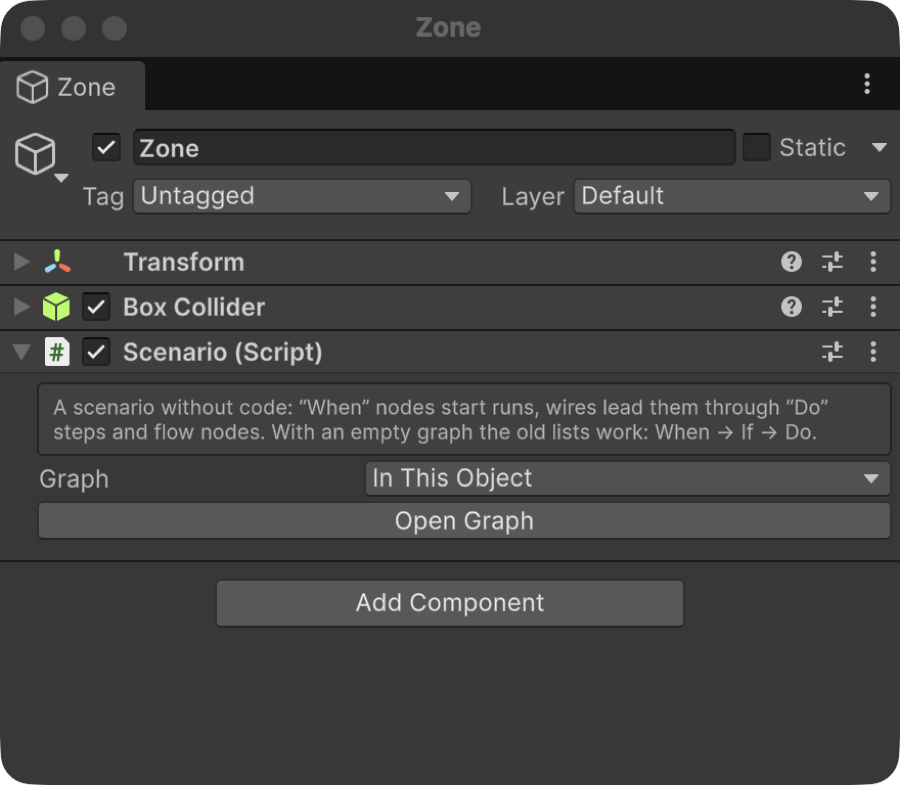
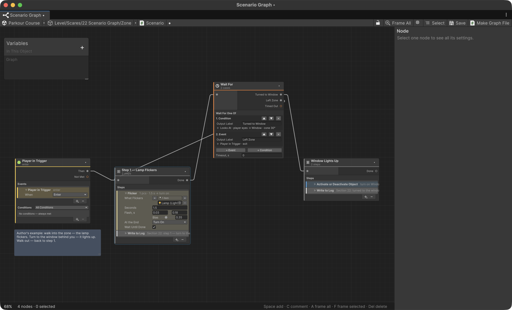
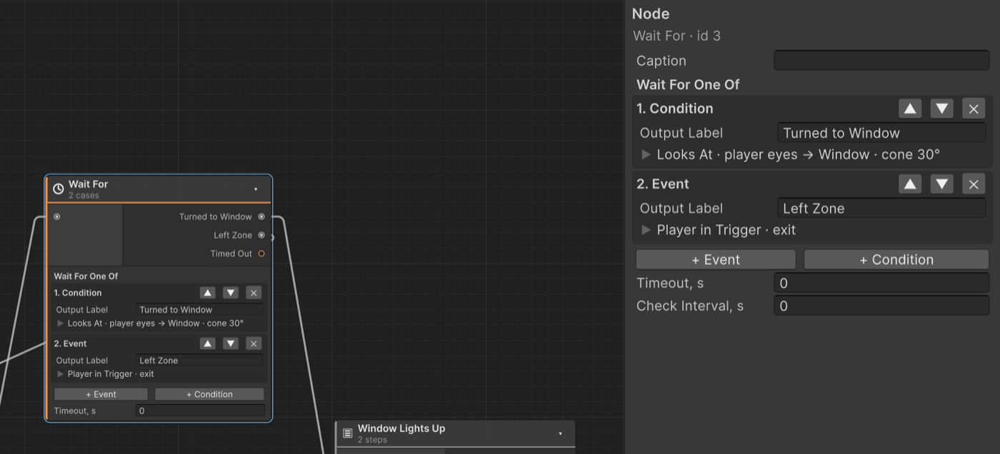
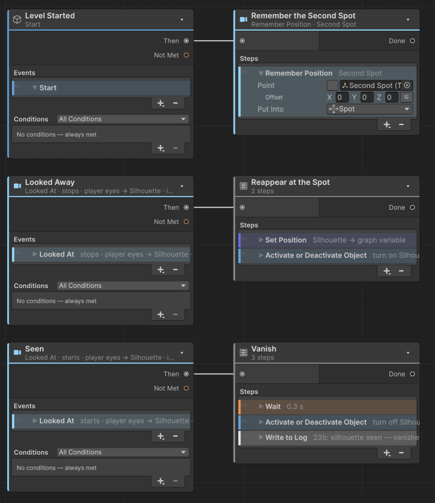
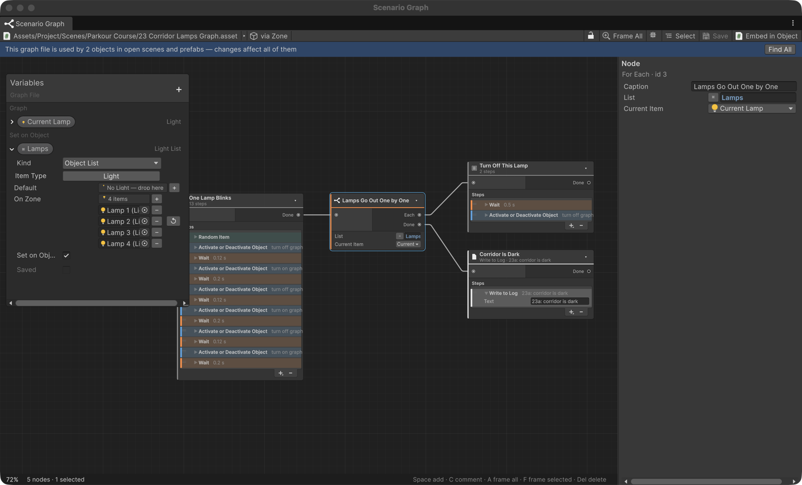
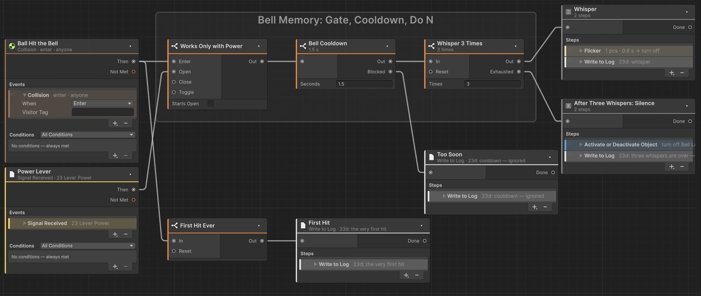
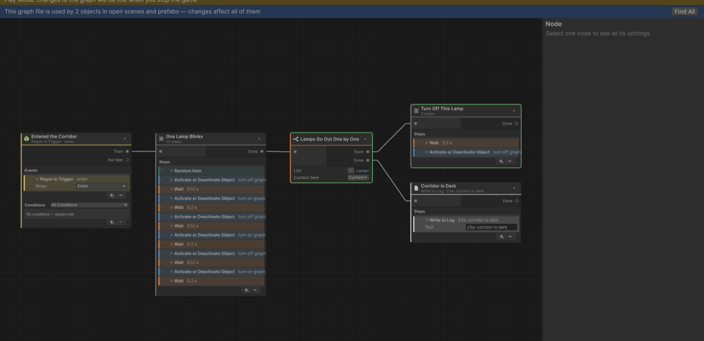
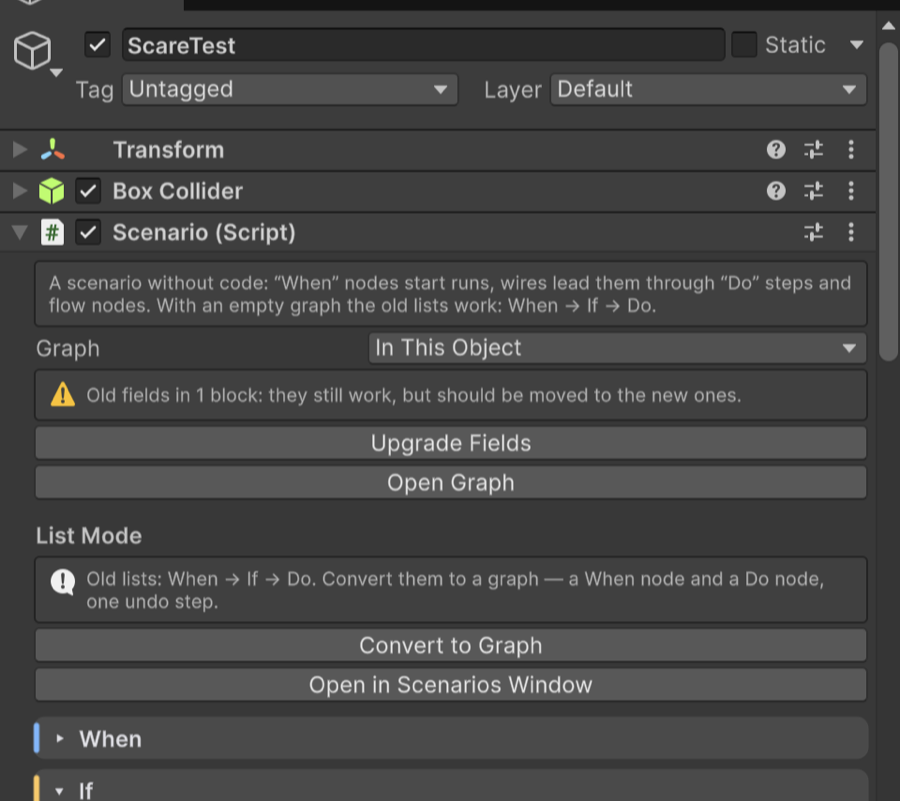

# Сценарии без кода

> Руководство модуля FeatherKit `Scenarios`. Как устроено внутри, все блоки и свой блок в коде — в [README](../README.md#модули), раздел Scenarios.

## За 2 минуты

Сценарий — это «если случилось вот это — сделай вот то», нарисованное схемой: квадратики-ноды и провода между ними.
Свет мигнул, дверь хлопнула, силуэт появился и исчез — без единой строчки кода.

1. Объекту на уровне — компонент **Scenario**, кнопка **Open Graph**.
2. Пробел на холсте — поиск, как Add Component: выбери событие, например «Player in Trigger», — появится нода **When** («когда»).
3. Протяни провод из её выхода **Then** в пустоту и выбери шаг, например «Flicker», — появится нода **Do** («сделай»).
4. Запусти игру — нода, на которой сейчас идёт сценарий, светится зелёной рамкой.

Руководство открывается из самого окна графа — кнопка **?** в его шапке (или меню FeatherKit → Scenarios → Guide).

## Пример: окно за спиной

Игрок заходит в комнату — над головой начинает мигать лампа. Пока он стоит и смотрит на неё, ничего не происходит.
Стоит обернуться — окно за спиной загорается. Испугался и вышел из комнаты — всё начнётся заново, когда он вернётся.

**1. Объект со сценарием.** Пустой объект с коллайдером-триггером (галка Is Trigger) на всю комнату — это «зона».
Добавляем ему **Scenario** и жмём **Open Graph**.

**2. Схема.** Читается слева направо, как комикс:

- **When** «Player in Trigger: Enter» — игрок вошёл в зону;
- **Do** «Step 1 — Lamp Flickers» — шаги идут сверху вниз: «Flicker» мигает лампой, «Write to Log» пишет в консоль;
- **Wait For** — сценарий останавливается и ждёт, что случится раньше;
- **Do** «Window Lights Up» — включает свет у окна.

**3. Ждать одного из двух.** У ноды **Wait For** («ждать») — исходы, у каждого свой выход:
«Turned to Window» — условие «Looks At» (глаза игрока смотрят на окно), «Left Zone» — событие «игрок вышел».
Провод из «Left Zone» ведём назад, в шаг 1, — так получается петля. Выделенная нода показывает все настройки справа.

Поля правятся прямо на нодах. Почти у каждого поля слева маленькая кнопка: «своё значение» или **переменная графа**
(о переменных — ниже). Пустое место на поле, которое заполнить обязательно, подсвечено красным, а значок «!» на ноде
говорит, что не так.

## Хочу, чтобы силуэт появлялся, когда игрок отвернулся

Игрок видит фигуру в конце коридора — она тут же пропадает. Отвернулся на полсекунды — фигура уже стоит в другом месте.

- **When** «Level Started» → «Remember Position»: запомнить точку, куда силуэт потом встанет, в переменную Spot.
- **When** «Looked At: Stops Looking», Hold Time 0,5 с → «Set Position» ставит силуэт в Spot, «Activate» его включает.
- **When** «Looked At: Starts Looking» → пауза 0,3 с и силуэт выключается.

«Looked At» считает, что игрок видит, только если цель в кадре камеры (с отступом от края) и между ними ничего нет
(галка **Clear View**): из-за ящика силуэт не «увидят».

## Хочу погасить все лампы коридора по очереди — и так в десяти одинаковых коридорах

Игрок входит — одна лампа нервно мигает, потом лампы гаснут одна за другой, и коридор погружается в темноту.

- **Переменные** — панель **Variables** слева на холсте. Здесь «Lamps» — список ламп (вид Object List), «Current Lamp» — та,
  до которой дошла очередь.
- «Random Item» выбирает случайную лампу и мигает ею. Нода **For Each** («для каждого») проходит список: на каждую лампу —
  выход Each («подождать и выключить»), в конце — Done.

Чтобы не собирать одно и то же в каждом коридоре, граф кладут в **файл** (Create → FeatherKit → Scenarios → Scenario Graph
или кнопка **Make Graph File** в шапке окна) и ставят этот файл на все коридоры. Лампы у каждого коридора свои:
у переменной галка **Set on Object**, и каждый объект указывает свои лампы — в панели переменных строка «On ‹объект›»,
в инспекторе `Scenario` — раздел Set on Object. Синяя полоса сверху напоминает, сколько объектов пользуются файлом.
Нужно сделать один коридор особенным — **Embed in Object**: файл копируется в объект, его лампы становятся значениями переменных.

Переменную можно просто перетащить из панели на поле ноды — подходящие поля подсветятся. В меню кнопки поля есть
«New Variable from Field»: сделать переменную из того, что уже стоит в поле.

## Хочу рычаг, который работает только три раза

Игрок толкает шар в колокол. Без питания колокол молчит. Включил питание — колокол шепчет, но не чаще раза в полторы секунды.
После третьего шёпота — тишина, сколько ни бей.

Здесь работают ноды потока, которые **помнят**, что уже было:

- **Gate** («ворота») пропускает, только пока открыта; открывает её второй **When** — сигнал рычага питания;
- **Cooldown** — не чаще раза в N секунд, лишнее уходит в выход Blocked;
- **Do N** — пропустит N раз, дальше — в выход Exhausted;
- **Once** — только самый первый раз.

Память живёт, пока жив объект. Нода «Stop Scenario» обрывает идущие шаги, но память оставляет; с галкой
«Reset Node Memory» — всё как в начале уровня.

Связанные ноды удобно обвести **рамкой**: выдели их и нажми Cmd/Ctrl+G, подпись — двойной клик по заголовку.

## Проверить в игре

Запусти игру с открытым окном графа: нода, на которой сейчас идёт сценарий, светится зелёным, провод, по которому
он только что прошёл, вспыхивает. Если граф-файл стоит на нескольких объектах, в шапке выбери, чей запуск смотреть, —
меню **Debug: ‹объект›**. Жёлтая полоса напоминает: правки графа в игре пропадут, когда её остановишь.

## Полезное по ходу

- **Копировать и вставлять** — Cmd/Ctrl+C, V, D, можно в другой граф и другую сцену. Объекты сцены, которые туда не
  перенести (в граф-файл или в чужую сцену), сбрасываются — об этом скажет плашка в окне.
- **Свернуть ноду** — кнопка ▾ в её шапке; **своя подпись ноды** — двойной клик по шапке; **миникарта** — кнопка в шапке окна.
- **Заметка** — клавиша C: подсказка себе и другим прямо на холсте.
- **Старые сценарии** (списки When → If → Do в инспекторе) работают как раньше; **Convert to Graph** перекладывает их в граф.
  Плашка «Old fields» — у блоков остались поля прежней версии: они работают, а **Upgrade Fields** переносит их в новые.

## Горячие клавиши

| Клавиша | Что делает |
|---|---|
| Пробел, правый клик | поиск нод |
| провод в пустоту | поиск, новая нода сразу соединится |
| C | заметка |
| A / F | показать весь граф / выделенное |
| Cmd/Ctrl + C, V, D | копировать, вставить, дублировать |
| Cmd/Ctrl + G | рамка вокруг выделенных нод |
| Delete | удалить выделенное |
| двойной клик по шапке ноды | своя подпись |
| два пальца / колесо | двигать холст |
| щипок, Cmd + колесо | приблизить, отдалить |
| пробел + тянуть мышью | двигать холст |

## Подробности

Все готовые ноды и блоки, как написать свой блок или ноду, как сценарий ведёт себя при остановке, паузе и столкновениях —
[README FeatherKit](../README.md#модули), раздел Scenarios.
