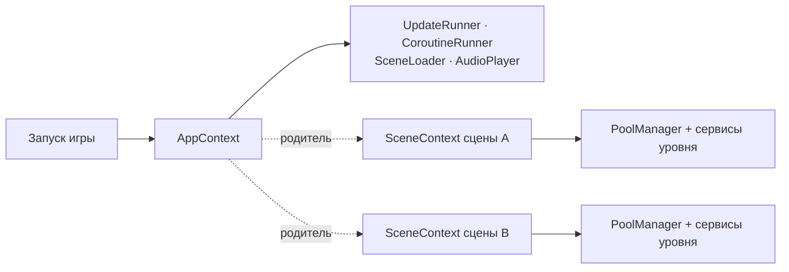

<div align="center">

# 🪶 FeatherKit

**Готовые кирпичики, которые нужны почти в каждой игре на Unity.**

[](https://unity.com)
[](https://docs.unity3d.com/Manual/urp/urp-introduction.html)
[](https://docs.unity3d.com/Packages/com.unity.cinemachine@3.1/manual/index.html)
[](LICENSE.md)

</div>

---

## Что это

В каждой новой игре приходится заново решать одни и те же задачи: поставить игру на паузу,
пока открыто меню; загрузить уровень с затемнением экрана; сохранить прогресс; не создавать
сотню пуль заново, а брать их из запаса. FeatherKit — это всё это, уже написанное и проверенное.
Подключаешь пакет и сразу занимаешься своей игрой.

Пример: игрок открыл инвентарь — игра должна замереть, а меню продолжать анимироваться.
С FeatherKit это одна строка `GameTime.Pause(this)`. Закрыл инвентарь — `GameTime.Resume(this)`.
Если в это время пауза стоит ещё и от диалога, игра не оживёт, пока не закроют оба.

Библиотека ничего не знает о конкретной игре: в ней нет ни игрока, ни врагов, ни уровней —
только каркас, на который игра вешает своё. Правило, по которому код попадает сюда, одно:
**он понадобится и в следующем проекте.**

## Что внутри

- **Сервисы.** Место, где лежат общие системы игры — счёт, спавнер, инвентарь. Любой
  скрипт достаёт нужную систему по типу, без поиска по сцене.
- **Пул объектов.** Пули, искры, всплывающие числа не создаются заново, а берутся из
  запаса и возвращаются в него. Игра не тормозит на частых выстрелах.
- **Время и пауза.** Пауза из разных мест одновременно, замедление времени, плавный
  переход в слоу-мо и обратно.
- **Уровни и сохранения.** Загрузка уровня с полосой прогресса и затемнением, сохранение
  прогресса в файл, которое не ломается, если игра вылетела посреди записи.
- **Здоровье и бонусы.** Запас здоровья и временные эффекты: «+20% к скорости на 10 секунд»,
  «неуязвим, пока действует зелье».
- **Отклик на удары.** Вылетающие цифры урона, полосы здоровья над врагами, вспышка модели
  при попадании, растворение убитого.
- **Иконки над миром.** Значок над дверью или квестовым персонажем; уходит за край экрана —
  прижимается к краю и показывает направление.
- **Визуальный скриптинг.** Простые события уровня собираются из блоков в инспекторе, без
  кода: «игрок вошёл в коридор → свет гаснет → крик».
- **Заготовки интерфейса.** Окна, подтверждение «Вы уверены?», бегущие цифры счёта, карусель
  карточек, учёт выреза экрана телефона.
- **Звук и камера.** Короткие звуки без лишних объектов на сцене, тряска и приближение камеры.
- **Рендер.** Мультяшный шейдер с обводкой, объёмный туман по высоте с клубами.
- **Случайность.** Выбор с весами («редкий лут — 5%») и поля для настройки разброса прямо в инспекторе.
- **Отладка.** Цветной лог, консоль с командами вроде `gold 500`, значения прямо на экране.
  В релиз ничего из этого не попадает.
- **Инструменты редактора.** Где используется этот ассет, закладки на частые объекты,
  перевод префабов в варианты, расстановка объектов кликом по поверхности.
- **Анимация человечков прямо в Unity.** Позируешь персонажа ручками, как в программе
  анимации, — готовый Humanoid-клип для игры собирается сам.

## Требования

| Что | Версия |
|---|---|
| Unity | 6000.0 и новее |
| Universal Render Pipeline | 17 и новее |
| Cinemachine | 3 и новее |
| uGUI (TextMeshPro входит) | 2 и новее |

Зависимости объявлены в `package.json`, Package Manager установит их сам.

Необязательно: **Animation Rigging** 1.0 и новее — для анимации человечков в редакторе.
Без него этот модуль просто не собирается, остальное работает как обычно.

## Установка

**Package Manager.** `Window → Package Manager → + → Add package from git URL…` и вставить:

```
https://github.com/gspyart/FeatherKit.git
```

**Вручную.** Добавить строку в `Packages/manifest.json`:

```json
"com.gspy.featherkit": "https://github.com/gspyart/FeatherKit.git"
```

Чтобы зафиксировать версию, добавьте к ссылке метку или коммит: `…/FeatherKit.git#v0.1.0`.

---

## Как устроено

Всё держится на трёх понятиях. Пример из жизни: в игре есть **счёт очков**. Он нужен
врагам (добавить очки за убийство), интерфейсу (показать) и экрану победы (сохранить рекорд).

**Сервис** — это и есть счёт очков: обычный C#-класс, который делает одну вещь. Ему не нужен
объект на сцене. Всё, что ему нужно для работы, он получает в конструкторе.

**Контекст** — общая полка, на которой лежат сервисы. Враг, интерфейс и экран победы берут
один и тот же счёт с полки, а не ищут его по сцене. Полок две:

- `AppContext` — одна на всю игру, живёт от запуска до выхода. Здесь то, что переживает
  смену уровней: настройки, сохранения, звук.
- `SceneContext` — своя у каждого уровня, исчезает вместе с ним. Здесь то, что нужно только
  на этом уровне: счёт, спавнер врагов. С полки уровня видно и общую полку игры.

**Инсталлер** — компонент на сцене, который расставляет полку уровня при загрузке и убирает
при выгрузке. Это единственное, что нужно положить на сцену.



### Что уже лежит на полках

Эти сервисы появляются сами, заводить их не нужно.

| Сервис | Откуда взять | Как пользоваться |
|---|---|---|
| `UpdateRunner` | `AppContext.Current.Updates` | Реализовать `IUpdatable` в сервисе, остальное сделает контекст |
| `CoroutineRunner` | `AppContext.Current.Coroutines` | `Coroutines.Run(...)`, остановка по токену |
| `SceneLoader` | `AppContext.Current.Scenes` | `Scenes.Load(levelConfig)` |
| `AudioPlayer` | `AppContext.Current.Audio` | `Audio.Play2D(clip)`, `Audio.Play3D(clip, point)` |
| `PoolManager` | `SceneContext.Get<PoolManager>()` | `pool.Get(prefab, position, rotation)` |
| `GameTime`, `EventBus`, `DebugConsole`, `DebugPanel` | статические классы | доступны отовсюду |

---

## Быстрый старт

Соберём тот самый счёт очков: сервис, полку уровня и доступ из врага.

### 1. Полка всей игры

Наследник `AppContext` кладёт на полку общие вещи. Точка входа поднимает его
до загрузки первой сцены.

```csharp
public class GameContext : AppContext
{
    public GameConfig Config { get; private set; }

    protected override void RegisterServices()
    {
        Config = Resources.Load<GameConfig>("GameConfig");
    }
}

public static class EntryPoint
{
    [RuntimeInitializeOnLoadMethod(RuntimeInitializeLoadType.BeforeSceneLoad)]
    private static void Boot() => AppContext.Launch(new GameContext());
}
```

### 2. Полка уровня

Наследник `SceneContext` кладёт на полку сервисы уровня. Что нужно спавнеру, видно
по его конструктору: пул и счёт.

```csharp
public class BattleContext : SceneContext
{
    protected override void RegisterServices()
    {
        var score = Register(new ScoreCounter());

        Register(new EnemySpawner(Get<PoolManager>(), score));
    }
}
```

### 3. Инсталлер на сцене

Пустой объект на сцене с этим компонентом. Больше на сцене ничего настраивать не нужно.

```csharp
public class BattleInstaller : SceneContextInstaller<BattleContext> { }
```

### 4. Взять сервис

Враг спрашивает полку **через себя** (`this`): так он получит полку именно своего уровня,
даже если загружено несколько.

```csharp
var score = AppContext.Current.GetContext<BattleContext>(this).GetRequired<ScoreCounter>();
```

`GetRequired` сразу падает с понятной ошибкой, если сервиса на полке нет.
`Get` в той же ситуации вернёт `null`.

### 5. Отклик на удар

- Перетащите на сцену префаб `Runtime/Prefabs/featherFeedbackCanvas`.
- Полоса здоровья над врагом: добавьте ему компонент `HealthBarTarget`.
- Цифра урона: `FloatingTextController.Show(point, value)`. Когда и что показывать, решает игра.
- Вспышка при ударе: компонент `HitFlash` на объект, материалы на шейдере `FeatherKit/Toon Lit`.
  Материал-шаблон лежит в `Runtime/Materials/featherToonTemplate`.

---

## Модули

У каждого модуля сначала — зачем он и пример, ниже — таблица классов. Подробности
и причины решений — в комментариях к самим классам.

<details>
<summary><b>Contexts</b> — полки для общих систем игры</summary>

Чтобы враг мог прибавить очки, ему не нужно искать счёт по сцене: он берёт его с полки уровня.
Как это устроено — в разделе [«Как устроено»](#как-устроено).

Любой компонент может достать сервис коротко: `this.GetService<ScoreCounter>()`.

| Класс | Назначение |
|---|---|
| `Context` | База полки. `Get` может вернуть `null`, `GetRequired` обязан найти |
| `AppContext` | Полка на весь запуск. `GetContext<T>(this)` отдаёт полку уровня вызывающего |
| `SceneContext` | Полка уровня, сама заводит себе `PoolManager` |
| `SceneContextInstaller<T>` | Компонент на сцене: ставит полку в `Awake`, убирает в `OnDestroy` |
| `SceneServiceResolver` | Находит компонент на сцене или создаёт его из префаба |
| `FContextUtils` | `this.GetService<T>()` для любого компонента |
| `IInitializable`, `IReleasable` | `Init()` — когда все сервисы уже на полке, `Release()` — при выгрузке, в обратном порядке |

</details>

<details>
<summary><b>Pooling, Entities</b> — запас объектов вместо создания заново</summary>

Создать объект в Unity дорого, а пулемёт делает десять выстрелов в секунду. Пул держит запас
пуль: выстрел берёт пулю из запаса, попадание возвращает её обратно. Ничего не создаётся
и не удаляется, игра не дёргается.

```csharp
var bullet = pool.Get(bulletPrefab, muzzle.position, muzzle.rotation);
```

Ловушка пулов — ссылка на пулю, которая уже вернулась в запас и стала другой пулей.
`PoolHandle<T>` эту ситуацию замечает.

| Класс | Назначение |
|---|---|
| `PoolManager` | Пулы уровня. Выдаёт объект или сразу нужный компонент на нём |
| `ObjectPool` | Пул одного префаба, используется только через `PoolManager` |
| `IPoolable` | `OnSpawned` и `OnDespawned` — сбросить состояние при выдаче и возврате |
| `PoolHandle<T>` | Ссылка, которая знает, что объект уже вернулся в пул |
| `FEntityBase` | База объектов из пула: рендереры, коллайдеры, теги, центр объекта |
| `UnitTag` | Тег как ассет — без опечаток в строках |
| `IObjectHeight` | Высота объекта — для всего, что рисуется над ним |

</details>

<details>
<summary><b>Health, Modifiers</b> — здоровье и временные эффекты</summary>

`Health` — просто запас: прибавить, отнять, умножить. Что считать уроном, броней или
лечением, решает игра.

Временные эффекты складываются по ключам. Пример: зелье скорости даёт +20% на 10 секунд,
кольцо — ещё +10% навсегда. Выпил второе зелье — его эффект не складывается с первым,
а обновляет срок, потому что ключ тот же.

| Класс | Назначение |
|---|---|
| `Health` | Запас здоровья. Что такое урон, решает игра |
| `HealthChange` | Изменение значения: прибавить, отнять, умножить, установить |
| `HealthChangedEvent` | Событие «здоровье изменилось» |
| `TimedModifiers<T>` | Вклады по ключам со сроком жизни. Готовые: `TimedBonuses`, `TimedMultipliers`, `TimedOffsets`, `TimedFlags` |

</details>

<details>
<summary><b>GameTiming, Updatables, Coroutines, Timers</b> — время, пауза и замедление</summary>

Пауза в играх ломается, когда её ставят из нескольких мест: меню сняло паузу — а диалог
ещё открыт, и игра ожила под ним. `GameTime` помнит, кто поставил паузу, и снимает её,
только когда отпустили все.

```csharp
GameTime.Pause(inventoryWindow);   // открыли инвентарь
GameTime.Resume(inventoryWindow);  // закрыли — игра оживёт, если пауз больше нет
```

Для обычных C#-классов есть кадровый апдейт и корутины — без объекта на сцене.

| Класс | Назначение |
|---|---|
| `GameTime` | Время игры и время интерфейса, пауза по источникам, замедление. Только он меняет `Time.timeScale` |
| `IUpdatable`, `UpdateRunner` | Кадровый апдейт для сервисов |
| `CoroutineRunner`, `CoroutineToken` | Корутины для обычных классов, переживают смену уровня |
| `Cooldown` | Перезарядка и таймер без `MonoBehaviour` |
| `IProgressable` | Прогресс 0..1 для полос загрузки |

</details>

<details>
<summary><b>Scenes, Saving</b> — загрузка уровней и сохранения</summary>

Переход на следующий уровень: экран темнеет, уровень грузится с полосой прогресса, экран
светлеет. `LevelTransition` делает всё это одним вызовом.

Сохранение пишется так, что вылет игры посреди записи не испортит файл: остаётся либо
старое сохранение, либо новое целиком.

```csharp
SaveStorage.Save("progress", progressData);
var progress = SaveStorage.Load<ProgressData>("progress");
```

| Класс | Назначение |
|---|---|
| `SceneLoader` | Загрузка уровня в фоне, с прогрессом и событиями этапов |
| `LevelConfig` | Уровень как ассет; свои поля игра добавляет наследником |
| `LevelTransition` | Переход целиком: затемнение, смена уровня, проявление |
| `ScreenCurtain`, `LoadingScreenView` | Затемнение и экран загрузки — заготовки под свой вид |
| `SaveStorage` | Сохранение в JSON-файл, без порчи при вылете |

</details>

<details>
<summary><b>Events, Registry, StateMachine, Collections, Randomness</b> — связки и случайность</summary>

- **События.** Враг погиб — и счёт, и достижения, и звук узнают об этом, а враг не знает
  ни про кого из них: `EventBus.Publish(new EnemyKilled(...))`.
- **Состояния.** Персонаж стоит, бежит или висит на уступе — каждое состояние отдельным
  классом, `StateMachine` переключает их.
- **Случайность с весами.** Обычный лут — 80%, редкий — 15%, легендарный — 5%.
- **Разброс в инспекторе.** Поле «урон 10 ± 2» или «пауза от 1 до 3 секунд»: дизайнер
  крутит цифры, код просто читает `Value` и получает новое случайное значение.

| Класс | Назначение |
|---|---|
| `EventBus` | События по типу, без очередей и приоритетов |
| `TypeRegistry<T>` | Список живых объектов типа; можно удалять прямо во время обхода |
| `StateMachine`, `IState` | Переключение состояний и их апдейт |
| `WeightedRandom<T>` | Случайный выбор с весами |
| `RandomSpread` | Поле «центр ± разброс», по желанию с границами. `Value` — новый бросок, `Min` и `Max` — края для подписей |
| `RandomRange` | Поле «от … до» с уклоном 0..1: 0 — всегда минимум, 0.5 — равномерно, 1 — всегда максимум |

</details>

<details>
<summary><b>Feedback</b> — отклик на удары и события</summary>

Удар должен ощущаться: над врагом вылетает «-25», полоска здоровья проседает, модель вспыхивает
белым. Убитый враг не исчезает разом, а растворяется. Всё это — готовые компоненты, игре
остаётся только сказать, когда.

| Класс | Назначение |
|---|---|
| `FloatingTextController`, `FloatingText`, `FloatingTextAnimationConfig` | Вылетающие цифры и надписи, вид задаёт префаб |
| `HealthBarController`, `HealthBarTarget`, `HealthBarView` | Полосы здоровья над объектами |
| `HitFlash` | Вспышка модели цветом при ударе; шейдеру нужно свойство `_HitFlash` |
| `DitherFade`, `MaterialCopies` | Растворение объекта и копии материалов для него |
| `PooledEffect` | Партикл из пула, возвращается в пул сам |
| `UiShake` | Элемент интерфейса трясётся — жест «нельзя» |

</details>

<details>
<summary><b>Icons</b> — значки над объектами мира</summary>

Восклицательный знак над квестовым персонажем: пока персонаж на экране, значок висит над ним;
отвернулся — значок прижимается к краю экрана и показывает, куда идти.

Кому и когда показывать значок, игра описывает правилами — например, «над дверью, если
у игрока есть от неё ключ».

| Класс | Назначение |
|---|---|
| `IconsRenderer` | Рисует значки в точках мира, прижимает к краю экрана, не даёт налезать друг на друга |
| `IconsTracker`, `TrackedIcon` | Держат значок над объектом или точкой |
| `IconRule`, `IconRulesRunner`, `IconRuleContext` | Правила-ассеты: кому и когда показывать |
| `IconRequest`, `IconView`, `OffscreenMode` | Заявка на значок, база вида значка, поведение за краем экрана |

</details>

<details>
<summary><b>Scenarios</b> — визуальный скриптинг</summary>

Простые события уровня — испуги, двери, свет, звук — собираются из блоков прямо в инспекторе,
без кода. Похоже на Scratch, только проще: каждый сценарий — одно правило
**«когда → если → что сделать»**.

Пример — испуг в коридоре:

- **Когда:** игрок вошёл в триггер коридора
- **Если:** испуг ещё не показывали
- **Что сделать:** погасить лампу → подождать секунду → проиграть крик → включить лампу

**Как пользоваться**

1. Добавьте объекту компонент `Scenario`.
2. В каждом из трёх разделов нажмите «+» и выберите блок — окно с поиском, как Add Component.
3. Шаги выполняются сверху вниз. Блоки «если — иначе», «повторить», «одновременно» держат
   внутри свой столбик шагов.
4. Запустите игру: идущий шаг подсвечен, сценарий можно запустить или оборвать кнопкой.

Когда сценариев много, удобнее окно **`FeatherKit → Сценарии`**: слева все сценарии сцены,
справа выбранный на всю ширину, внизу журнал — какой сценарий сработал, какой нет и почему.

Для испугов пригодится галка «Только один раз». Чтобы сценарии общались между собой, есть
флаги («дверь открыта»), счётчики («собрано ключей: 2») и сигналы («погасить весь этаж»).

**Готовые блоки** — по категориям, как в меню «+»

| Раздел | Категория | Блоки |
|---|---|---|
| Когда | Объект | старт, каждый кадр или раз в N секунд |
| | Триггер | объект с тегом в триггере: вход, выход, «пока внутри» |
| | Переменные | флаг изменился, счётчик изменился |
| | Сигналы | сигнал получен |
| Если | Логика | группа условий, шанс |
| | Переменные | флаг включён, сравнить счётчик |
| | Объект | объект включён |
| Что сделать | Управление | подождать, ждать пока, если — иначе, случайно одно из, одновременно, повторить |
| | Сценарий | запустить сценарий, остановить сценарий |
| | Объект | включить или выключить объект или компонент |
| | Трансформ | переместить к точке — сразу или плавно |
| | Свет | мигание, плавная яркость |
| | Звук | проиграть звук |
| | Анимация | триггер аниматора, проиграть Timeline |
| | Переменные | изменить флаг, изменить счётчик |
| | Сигналы | послать сигнал |
| | Код, Отладка | вызвать методы (UnityEvent), записать в лог |

**Свой блок** — маленький класс. Он сам появится в меню «+».

```csharp
[Serializable]
[ScenarioBlock("Свет/Мигнуть")]
public class BlinkLightAction : ScenarioAction
{
    [ScenarioLabel("Лампа")]
    [SerializeField] private Light lamp;

    public override IEnumerator Perform(ScenarioRun run)
    {
        lamp.enabled = false;
        yield return new WaitForSeconds(0.1f);
        lamp.enabled = true;
    }
}
```

**Подробности**

- У каждого условия есть галка «НЕ». Сложная логика — вложенными группами:
  «(a или b) и (b или c)» — это «Все» → [группа «хотя бы одно»: a, b] + [группа «хотя бы одно»: b, c].
- На кого действует блок: на этот объект, на того, кто запустил сценарий, на игрока или на
  конкретный объект. Кто такой «игрок», игра задаёт через `ScenarioTarget.PlayerFinder`.
- Пустое поле компонента (аниматор, Timeline) — берётся компонент с объекта сценария.
- Пока сценарий идёт, повторный запуск пропускается.
- «Сработать, когда условие сойдётся» — триггер «пока внутри» или «каждый кадр» плюс условие.
- Пустой звук не обрывает сценарий: предупреждение в консоль, шаг пропускается.
- Выключение объекта сценарий не обрывает; удаление объекта и «Остановить» — обрывают,
  в том числе все ветки «одновременно».
- Ошибка в шаге на любой глубине обрывает сценарий и пишет, на каком шаге.
- Запуск снаружи: `TryRun(instigator)` из кода, `Run()` — из UnityEvent и сигналов Timeline.
- Свой блок: класс с `[Serializable]` и `[ScenarioBlock("Категория/Название")]`, наследник одной
  из баз. Подписи полей — `[ScenarioLabel("…")]`, вложенный столбик — поле `ScenarioActionList`
  или `ScenarioConditionList`. Переименовали класс — пометьте его `[MovedFrom]`, иначе блоки
  на сценах потеряются.
- Цвет категории задаёт `ScenarioBlockStyle`; новая категория без цвета — серая.

| Класс | Назначение |
|---|---|
| `Scenario` | Компонент: события, условия, шаги, запуск и остановка |
| `ScenarioEvent`, `ScenarioCondition`, `ScenarioAction`, `ScenarioInstantAction` | Базы блоков «Когда», «Если», «Что сделать»; шаг без ожидания |
| `ScenarioActionList`, `ScenarioConditionList` | Вложенный столбик шагов или условий внутри блока |
| `ScenarioTarget` | На какой объект действует блок |
| `ScenarioBlockAttribute`, `ScenarioLabelAttribute` | Путь блока в меню «+»; подпись поля |
| `ScenarioRun` | Один запуск: чей сценарий, кто его вызвал, остановлен ли |
| `ScenarioSteps` | Выполняет вложенные шаги; ошибка на любой глубине доходит до сценария |
| `ScenarioFlag`, `ScenarioCounter`, `ScenarioSignal` | Флаг, счётчик и сигнал как ассеты: Create → FeatherKit → Scenarios |
| `ScenarioFlags`, `ScenarioCounters`, `ScenarioSignals` | Их значения на весь запуск игры и рассылка сигналов |
| `TriggerEvent` | База «вошёл в триггер или вышел»: игра решает, кто считается гостем |
| `ScenarioRunRecord` | Чем кончилась попытка запуска — для журнала в окне сценариев |
| `SwitchableComponents` | Включить и выключить компонент любого вида: скрипт, свет, рендерер, коллайдер |

</details>

<details>
<summary><b>UI</b> — заготовки интерфейса</summary>

То, что есть почти в каждой игре: окно «Вы уверены?», счёт монет, который бежит вверх, а не
прыгает, кнопка, которая пружинит при нажатии, монетка, которая летит из сундука в счётчик.

| Класс | Назначение |
|---|---|
| `UiWindowBase`, `ConfirmWindow`, `IShowHideAnimation` | Окно с `Open`, `Close`, `Toggle`, очередь окон, анимация показа |
| `UiBounce`, `UiPressBounce`, `TotalGrowthBounce` | Пружинка масштабом по событию, нажатию, росту числа |
| `RollingNumberText` | Бегущее число в TextMeshPro |
| `FlyingIcon` | Картинка летит из мира или интерфейса в цель |
| `UiCarousel`, `UiGestureRecognizer` | Карусель карточек; жесты: тап, удержание, перетаскивание |
| `ScrollList`, `ScrollEdgeFade`, `GridCellFitter`, `ViewList`, `UiObjectPool` | Списки, мягкий край прокрутки, сетка, ряд элементов из префаба |
| `SafeAreaFitter`, `FullScreenRect` | Отступ от выреза экрана телефона, растяжка на весь экран |

</details>

<details>
<summary><b>Audio, CameraEffects, Navigation, Rendering</b> — звук, камера, путь, картинка</summary>

- **Звук.** Короткий звук шага или выстрела — одна строка `Audio.Play3D(clip, point)`, без
  объекта на сцене. Длинный звук, который надо зациклить или оборвать, — источник из пула.
- **Камера.** Тряска при взрыве и приближение при прицеливании — для Cinemachine.
- **Путь.** Враг находит направление к игроку по навмешу без `NavMeshAgent` и обходит
  препятствия.
- **Туман по высоте.** Низина затянута туманом, а на холме ясно; в тумане видно клубы и лучи
  от фонарей. Отдельные облака тумана можно поставить в комнату или яму.
- **Свой рендерер на уровень.** Одна сцена в пикселях, другая с полным качеством —
  без ручного переключения настроек.

| Класс | Назначение |
|---|---|
| `AudioPlayer` | Короткие звуки 2D и 3D по кругу каналов, без объектов на сцене |
| `PooledAudioSource` | Источник звука из пула: зациклить, оборвать, перемещать |
| `CameraShake`, `ShakeProfile`, `CameraZoom` | Тряска и приближение для Cinemachine |
| `NavMeshPathfinder`, `ObstacleScanner` | Направление по навмешу без `NavMeshAgent`, обход препятствий лучами |
| `HeightFogVolume` | Общий туман по высоте через Volume. Нужна `HeightFogFeature` в рендерере с текстурой клубов `featherHeightFogNoise`. Может подниматься вместе с камерой. Качество — пресетами в фиче |
| `FogArea` | Облако тумана — коробка или шар — в комнате или яме, видно со стороны. Настройки свои; внутри может заменить общий туман или убрать его |
| `FogLightSettings` | На источнике света: насколько ярко он светит в тумане и даёт ли в нём тень |
| `ToonLitSettingsFeature` | Общие настройки мультяшного шейдера на проект |
| `CameraRendererOverride`, `RenderPipelineOverride` | Свой рендерер или ассет URP на время сцены |

</details>

<details>
<summary><b>Debugging</b> — отладка</summary>

Пока делаешь игру, хочется видеть цифры прямо на экране и подкручивать игру командами:
«дать 500 золота», «перейти на уровень 3». Всё это есть и целиком вырезается из релиза.

```csharp
DebugPanel.Watch(this, "Игрок", "Скорость", () => speed.ToString("0.0"));
```

| Класс | Назначение |
|---|---|
| `FLog`, `FLogColor`, `FLogPart` | Лог из цветных кусков. `Info` и `Warning` вырезаются из релиза |
| `DebugConsole`, `DebugCommand`, `DebugCommandButton` | Текстовые команды вроде `gold 500`. В релизе не регистрируются |
| `DebugPanel`, `DebugAnchor`, `DebugPanelStyle` | Окна «название — значение» на экране; окно можно скрыть и показать по имени. Списки и многострочный текст — `WatchBlock`. В релизе вырезаются |
| `FGizmos` | Гизмо: силуэт префаба, стрелки, дуги |

</details>

<details>
<summary><b>Helpers</b> — мелкие помощники</summary>

То, что каждый раз пишешь заново: случайный элемент списка, «12 500» → «12.5K», поставить
объект на землю, проверить, виден ли объект камере.

| Класс | Назначение |
|---|---|
| `FComponentUtils` | `GetOrAddComponent`. Единственный класс вне пространства имён |
| `FCollectionUtils` | Случайный элемент, выборка без повторов, перемешивание |
| `FVector3Utils`, `FTransformUtils` | `ReplaceX/Y/Z`, `SetX/Y/Z`, телепорт объекта с `Rigidbody` |
| `FDistanceUtils`, `FDirectionUtils`, `FGroundUtils` | Расстояния по плоскости с учётом размеров, ввод в направление в мире, посадка на землю |
| `FCameraUtils`, `ScreenPoint` | Виден ли объект; точка мира или интерфейса в пиксели экрана |
| `FNumberUtils`, `FTimeFormatUtils` | Форматы `10K`, `x12`, `+5`, `12:34` |
| `FObjectIdUtils` | Стабильный номер объекта на любой версии Unity |
| `FDescriptionAttribute` | Описание компонента в инспекторе |

</details>

<details>
<summary><b>Editor</b> — инструменты редактора</summary>

Мелочи, которые экономят время каждый день. Пример: хочешь удалить старую текстуру, но
не знаешь, где она ещё нужна, — ПКМ → Find Usages покажет все места.

| Инструмент | Где найти |
|---|---|
| Где используется ассет | ПКМ по ассету → `Find Usages`, или `FeatherKit → Asset Usage Finder` |
| Перевод префабов в варианты общего шаблона с починкой ссылок | ПКМ по префабам → `Make Variants of Template…`, или `FeatherKit → Prefabs to Variants` |
| Все материалы сцены в одном окне | `FeatherKit → Scene Materials` |
| Своя копия материала у одного объекта | `FeatherKit → Make Material Unique in Scene` или ПКМ по рендереру |
| Закладки на ассеты и объекты сцен: вкладки, в каждой свои папки. Общие закладки лежат в `ProjectSettings/FeatherKit` и попадают в git | `FeatherKit → Bookmarks`, ПКМ в Project и Hierarchy → `Add to Bookmarks` |
| Свои иконки ассетам | `FeatherKit → Asset Icons`, ПКМ по ассету → `Assign Icon` |
| Текстура клубов для тумана по высоте | `FeatherKit → Bake Fog Noise` |
| Гизмо в Game View | `FeatherKit → Game View Gizmos`, Ctrl/Cmd+Alt+G |
| Расстановка выделенного: на поверхность под кликом (встаёт низом, наклоняется по поверхности), к камере сцены, к камере с её поворотом. Ctrl+Z отменяет | Панель `Object Placement` в окне сцены |
| Фильтр карт света: после каждого запекания ставит выбранный сам (Point — свет квадратами, как в старых играх). Настройки общие, в `ProjectSettings/FeatherKit`; по умолчанию выключен | `Project Settings → FeatherKit → Lightmaps`, `FeatherKit → Lightmap Filter After Baking` |
| Инспекторы мультяшных шейдеров, база для своих инспекторов | `ToonLitShaderGUI`, `ToonTerrainShaderGUI`, `FeatherEditor` |
| Отрисовка полей `RandomSpread` и `RandomRange` | Сама, через `RandomSpreadDrawer`, `RandomRangeDrawer` |
| Инспектор сценария из цветных блоков | Сам, через `ScenarioEditor` и соседние классы в `Editor/FeatherKit/Scenarios` |
| Окно сценариев: все сценарии сцены, редактор на всю ширину, журнал запусков | `FeatherKit → Сценарии` или кнопка в инспекторе сценария |

</details>

<details>
<summary><b>HumanoidAnimation</b> — анимация человечков прямо в Unity</summary>

Нужна короткая анимация — персонаж хватается за уступ или отмахивается. Обычно это поход
в Blender или Maya. Здесь можно поставить позу прямо в Unity: тянешь кисть — рука сгибается
сама, ставишь несколько поз в разные моменты времени, и готовый Humanoid-клип для игры
собирается сам.

Зачем модуль: окно Animation в Unity умеет записывать только повороты костей, а Humanoid-клипу
нужны «мышцы» аватара. Модуль переводит одно в другое. Нужен пакет Animation Rigging.

**Как пользоваться**

1. ПКМ по персонажу в Hierarchy или по его модели в Project (Rig → Humanoid) →
   `FeatherKit → Animate Humanoid` (или `FeatherKit → Humanoid Animation → Animate Selected`).
   Рядом появится рабочая копия с ручками; инструмент спросит имя анимации и сразу включит
   предпросмотр и запись. Оригинал и префаб не меняются, копия в билд не попадает.
2. Кликайте прямо по телу и двигайте: клик по руке выделит нужную ручку, инструмент
   (двигать или вращать) выберется сам. Ключ ставится всей позе сразу.
3. Время, ключи, проигрывание, копирование и зеркало позы — на панели `Humanoid Animation`
   в окне сцены. Ромбик ключа можно перетащить на другой кадр.
4. «Готово» — игровой клип обновится. Ctrl+S и запуск игры обновляют его тоже.

Одна анимация — один файл `Имя.anim`: снаружи это обычный Humanoid-клип для аниматора игры,
внутри спрятан исходник с ручками. Двойной клик по такому файлу открывает его на персонаже,
а если персонажа на сцене нет — предлагает создать его из модели, на которой анимацию делали.

**FK или IK.** У каждой руки и ноги две кнопки FK | IK. FK — вращаешь сустав за суставом,
удобно для маха руками и замахов. IK — тянешь кисть или стопу, и конечность сгибается сама,
удобно для хвата за опору и стоп на полу. По умолчанию руки в FK, ноги в IK. При переключении
конечность не прыгает: ручки нового режима встают в текущую позу.

**Панель в окне сцены** появляется, когда выделено что-то внутри персонажа:

| Что | Зачем |
|---|---|
| Анимация ▾, «Готово» | Другая анимация персонажа или новая; закончить и обновить игровой клип |
| Полоска времени | Клик — перейти к кадру, ромбик — ключ позы, его можно перетащить |
| Кнопки под полоской | К прошлому и следующему ключу, проиграть по кругу; «+ ключ», «− ключ»; значок повтора — зацикливать ли клип в игре |
| «Копировать», «Вставить», «Зеркально» | Поза в другой кадр — как есть или левое на место правого (шаг левой → шаг правой) |
| «Глазами» | Камера сцены встаёт в глаза персонажа — видно позу от первого лица |
| Руки и ноги, схема тела | Режимы FK/IK и выбор ручки кнопкой, если кликом по телу неудобно |

**Ручки**

| Ручка | Как управлять | Что делает |
|---|---|---|
| Таз (квадрат) | двигать и вращать | Всё тело |
| Живот, грудь, шея, голова, ключицы (кольца) | вращать | Поворот кости, уносит за собой всё, что выше |
| Руки и ноги в **FK** (кольца) | вращать | Сустав за суставом: плечо → локоть → кисть, бедро → колено → стопа |
| Руки и ноги в **IK**: кисти, стопы (кубики) | двигать и вращать | Тянешь — конечность сгибается сама |
| Руки и ноги в **IK**: локти, колени (шарики) | двигать | Куда смотрит сгиб |
| Пальцы (кольца) | вращать | Поворот фаланг. Включаются в «Настройка рига» |

**Подробности**

- Готовый клип обновляется на месте: его настройки (корень, зацикливание, зеркало) и события
  не трогаются. Чужой файл с тем же именем не перезаписывается.
- Клип собирается на том персонаже, которому принадлежит: из его контроллера или с привязанной
  к нему дорожки Timeline. Несколько персонажей на одной сцене друг другу не мешают.
- Персонаж помнит свой контроллер: потерялся после Ctrl+Z — вернётся, когда персонажа выделят.
  Любой клип можно открыть на персонаже из инспектора, раздел «Анимации».
- Сеанс анимации помнится до закрытия редактора: кликнул мимо и вернулся — предпросмотр
  и запись включатся сами.
- Клик по телу выбирает ручку текущего режима: рука в IK — по плечу шарик локтя, ниже — кубик
  кисти; в FK — кольцо того сустава, по которому кликнули.
- В инспекторе есть ползунок смеси FK ⟷ IK. Руки на старте чуть согнуты: у прямой руки
  шарику локтя нечего направлять.
- Окно Animation и Timeline работают как обычно: панель управляет окном Animation, а не
  заменяет его. Кривые и тонкую правку ключей делайте в нём.
- Старые анимации парой `Клип` + `Клип_Humanoid` работают как раньше. Собрать пару в один
  файл — кнопка «В один файл» в инспекторе: ссылки игры на клип сохранятся.

| Класс | Назначение |
|---|---|
| `HumanoidAnimationRig`, `HumanoidRigControl` | Компонент рабочей копии и описание одной ручки |
| `HumanoidWorkingCopyCreator` | Копия персонажа: только скелет, меши и Animator |
| `HumanoidRigLimb` | Рука или нога: кости и вес IK — режим FK/IK |
| `HumanoidRigControlsBuilder`, `HumanoidRigLimbBuilder`, `HumanoidRigParts` | Сборка ручек: корпус и пальцы, конечность с FK и IK, общие детали |
| `HumanoidLimbModeSwitcher`, `HumanoidLimbModePanel` | Переключение FK/IK без скачка позы, кнопки режимов |
| `HumanoidTimelineFootIKGuard` | Выключает Foot IK на дорожках Timeline с ригом — иначе стопы уезжают |
| `HumanoidClipBaker`, `HumanPoseCurves` | Покадровый перевод позы в мышцы Humanoid-клипа |
| `HumanoidAnimationFiles` | Файл анимации: игровой клип со спрятанным исходником; старая пара в один файл |
| `HumanoidSourceClips` | Какие клипы анимируют ручки, чей клип, куда класть результат |
| `HumanoidRigClipLibrary` | Запоминает и возвращает контроллер персонажа, подключает к нему клипы |
| `HumanoidClipAutoBaker` | Пересборка по Ctrl+S, перед запуском игры, по «Готово» |
| `HumanoidAnimationLauncher` | «Анимировать» одной командой; двойной клик по анимации |
| `HumanoidAnimationSession`, `HumanoidAnimationWindowRemote` | Сеанс анимации; пульт окна Animation: клип, предпросмотр, запись, время |
| `HumanoidPoseKeys`, `HumanoidPoseAutoKeyer` | Ключи позы: поставить, убрать, перенести; ключ всей позе при сдвиге ручки |
| `HumanoidPoseClipboard` | Копировать и вставить позу, зеркало через мышцы Humanoid |
| `HumanoidBodyClickPicker`, `HumanoidBodyHitTest`, `HumanoidControlToolSwitcher` | Выбор ручки кликом по телу, инструмент под ручку |
| `HumanoidEyesView` | Камера сцены в глаза персонажа |
| `HumanoidAnimationRigEditor`, `HumanoidAnimationOverlay`, `HumanoidTimePanel`, `HumanoidTimeBar`, `HumanoidPosePanel`, `HumanoidBodyPicker` | Инспектор, панель в сцене и её части, схема тела |

</details>

---

## Готовые ассеты

### Префабы

Лежат в `Runtime/Prefabs`. Это нейтральные заготовки: под свою игру создайте **вариант**
(ПКМ → Create → Prefab Variant) и настраивайте его, оригинал не трогайте — так обновление
пакета не затрёт ваши правки.

| Префаб | Что это |
|---|---|
| `featherFeedbackCanvas` | Канвас для цифр урона и полос здоровья, один на сцену |
| `featherFloatingText` | Одна вылетающая надпись, вид задаёт её TextMeshPro |
| `featherHealthBar` | Полоса здоровья: фон, «хвост» урона, шкала |
| `featherPooledAudioSource` | Источник звука из пула |
| `featherPooledEffect` | Партикл из пула |
| `featherFloatingTextAnimation` | Как летят надписи: высота, разброс, кривые |

Шрифт у `featherFloatingText` не задан намеренно: TextMeshPro подставит шрифт проекта.

### Шейдеры

| Шейдер | Что это |
|---|---|
| `FeatherKit/Toon Lit` | Мультяшный свет ступенями, обводка, вспышка удара, растворение. Шаблон материала `featherToonTemplate` |
| `FeatherKit/Toon Terrain` | То же для земли с раскраской по вершинам, до четырёх слоёв |
| `FeatherKit/Height Fog` | Туман по высоте и облака тумана. По желанию освещается сценой — подсветка, солнце и лампы с тенями; можно оставить одни лучи без пелены. Настраивается через `HeightFogVolume` и `FogArea` |
| `FeatherKit/Masked Swirl` | Декоративное свечение для интерфейса |

### Текстуры

| Текстура | Что это |
|---|---|
| `featherHeightFogNoise` | 3D-текстура клубов для тумана, 128³, повторяется без шва. Кладётся в `HeightFogFeature` |

---

## Принципы

- **Библиотека не знает про игру.** Всё игровое игра подставляет сама.
- **Никаких поисков по сцене во время игры.** Объект сам записывается в нужный сервис в `OnEnable`.
- **Статика сбрасывается при входе в игру** через `RuntimeInitializeOnLoadMethod` — можно
  выключить перезагрузку домена и запускать игру быстрее.
- **Всё нужное приходит в конструктор.** Полку целиком передаём, только если иначе никак;
  тогда сервис берёт нужное в `Init()`.
- **Префикс `F`** отличает классы библиотеки от похожих в Unity: `FLog` и `Debug.Log`,
  `FGizmos` и `Gizmos`.
- **Файлы ассетов — с префиксом `feather`** и с маленькой буквы.
- **Комментарий объясняет, почему так, а не что происходит.**

## Ограничения

- Сохранения через `JsonUtility`: только поля `[Serializable]`-классов, без словарей,
  свойств и наследников вместо базы.
- Туман по высоте работает только с Render Graph.
- Анимация человечков:
  - кости вне аватара (оружие, волосы) в Humanoid-клип не попадают, позы за пределами мышц
    аватара срезаются;
  - пересборка по Ctrl+S и перед запуском игры работает, пока рабочая копия есть в открытой сцене;
    в Play Mode инструмент ничего не меняет;
  - чужие Humanoid-клипы (Mixamo) ручками не правятся: в них нет ключей ручек;
  - у очень толстых или тонких моделей клик по телу попадает чуть неточно — тогда выручит схема тела;
  - ручки без ключей собираются в исходной позе: что не записано в клип, в результат не попадёт.
- `HitFlash` ждёт в шейдере свойства `_HitFlash` и `_HitFlashColor`, имена настраиваются.
- Расстояния и направления в `Helpers` и `Navigation` считаются по горизонтальной плоскости.
  Для вертикального геймплея нужны свои.
- Локализации, аналитики, сети и ECS в библиотеке нет и не планируется.

## Разработка

Чтобы править саму библиотеку, удобнее подключить её как локальный пакет. Клонируйте
репозиторий рядом с проектом и укажите путь в `Packages/manifest.json`:

```json
"com.gspy.featherkit": "file:../../FeatherKit"
```

Unity покажет пакет как редактируемый, изменения сразу попадут в клон.

## Лицензия

[MIT](LICENSE.md) © gspy. Свободное использование с сохранением авторства.
